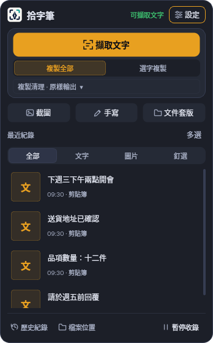
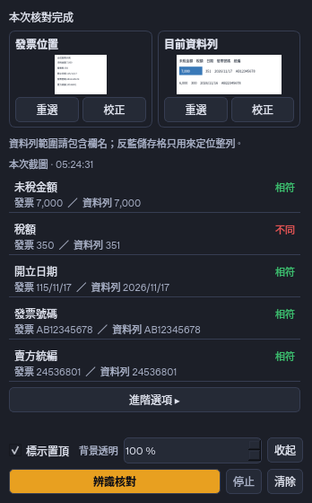
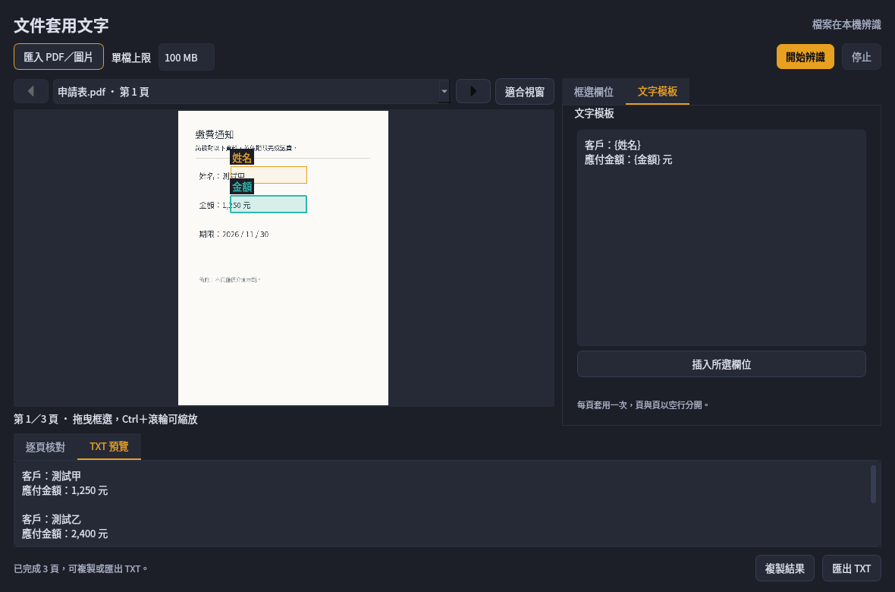
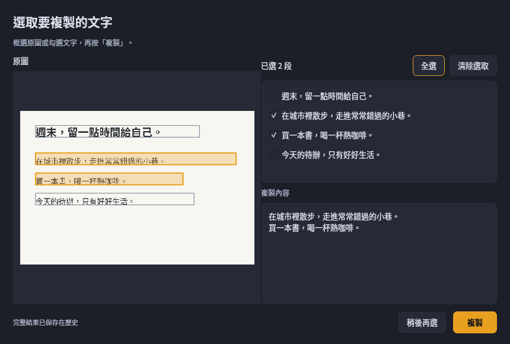
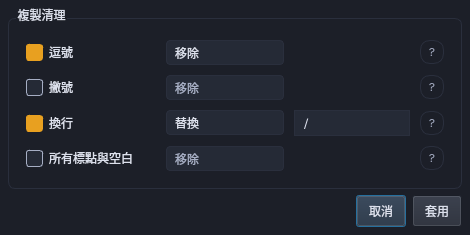
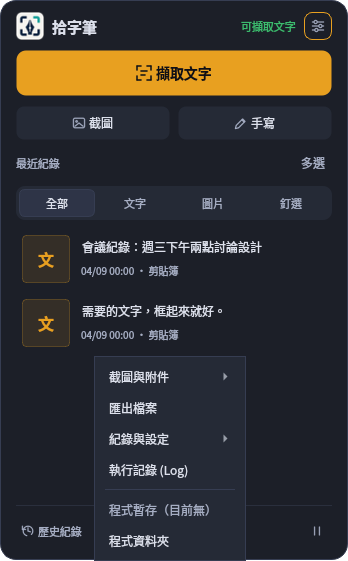

# InkPick 拾字筆

Windows 10（1809 以上）／Windows 11 的 64 位元離線文字工具。可框選螢幕辨識文字、手寫單字找候選，也能匯入 PDF／圖片，把固定位置的欄位逐頁填入文字模板，最後複製或匯出 TXT。

本版為 **1.8.0-rc.21 候選版**，延續文件套版、螢幕擷取、複製模式、手寫、歷史與檔案位置功能。EXE 包含 Python、Qt、PDFium、兩組 OCR 模型及手寫引擎；使用電腦不需安裝 Python、pip、PDF 閱讀器或 Windows 手寫語言套件，也不需連線下載模型。

保留前版對連續操作的修正：最小化後重新開啟仍看不到視窗、取消框選後沿用舊座標，以及退出期間仍收到舊對話框的儲存操作。手寫視窗隱藏後會停止延遲辨識，重新開啟也不會自動送出舊筆畫。具體觸發步驟與回歸測試見 [浮窗狀態檢查](docs/FLOATING_STATE_AUDIT.md)。

本版新增 **發票 QR 品項**。框住台灣電子發票的左右 QR Code，就能讀取條碼收錄的品名、數量和單價，並複製為可貼進試算表的三欄明細。

沿用前版的套件修補與背景工作回收：手寫完成後結束輔助程序，OCR 閒置時停用 CPU 忙等。移除的功能不再提供背景辨識入口。GUI、PE 原生元件、套件與防毒的檢查項目及尚未證明的範圍見 [本版驗證範圍](docs/VALIDATION_COVERAGE.md)。套件掃描及網路觀察方法見 [資安與背景工作檢查](docs/SECURITY_REVIEW.md)，設定、旁支與停用節點的掃描範圍見 [設定接線與節點稽核](docs/CONFIG_WIRING_MATRIX.md)。

## 下載與第一次執行

從 [v1.8.0-rc.21 Release](https://github.com/maotai11/desktop-ocr-tool/releases/tag/v1.8.0-rc.21) 下載：

| 檔案 | 用途 |
| --- | --- |
| [InkPick-v1.8.0-rc.21.zip](https://github.com/maotai11/desktop-ocr-tool/releases/download/v1.8.0-rc.21/InkPick-v1.8.0-rc.21.zip) | 建議使用。包含 EXE、離線操作說明、文件套版圖文說明、授權與手寫模型來源 |
| [InkPick-v1.8.0-rc.21.exe](https://github.com/maotai11/desktop-ocr-tool/releases/download/v1.8.0-rc.21/InkPick-v1.8.0-rc.21.exe) | 同版單一執行檔；PDF 引擎、模型與執行環境已包在裡面 |
| [InkPick-v1.8.0-rc.21-README.txt](https://github.com/maotai11/desktop-ocr-tool/releases/download/v1.8.0-rc.21/InkPick-v1.8.0-rc.21-README.txt) | 可單獨下載的離線操作說明，與 ZIP 內 `OFFLINE_README.txt` 內容相同 |
| InkPick-v1.8.0-rc.21-SHA256SUMS.txt | 核對同版下載檔案的 SHA256 |
| InkPick-v1.8.0-rc.21-validation-metadata.zip | 同次建置的去識別驗證摘要，不是執行必需檔案 |

1. 在可上網的電腦下載 ZIP，再用隨身碟帶到離線電腦。
2. 解壓到自己有寫入權限的資料夾，例如 `D:\Tools\InkPick`。不要直接從 ZIP 裡執行，也不要放在受保護的 Program Files。
3. 執行 `InkPick-v1.8.0-rc.21.exe`，不需管理員權限。預設縮到右下角系統匣，點拾字筆圖示開啟浮動窗。
4. 首次開啟會解開內含資源並載入模型。浮動窗顯示「可擷取文字」後，即可使用。
5. 結束程式請用系統匣的結束選項，讓尚未完成的辨識與儲存先結束。

核對檔案可用 PowerShell：`Get-FileHash .\InkPick-v1.8.0-rc.21.exe -Algorithm SHA256`，與同版 SHA256SUMS 的 EXE 那一列比對。ZIP 內的 `OFFLINE_README.txt` 與 `README.txt` 是相同的完整文字說明，可直接用記事本閱讀。

## 主浮窗的複製控制

- **複製全部／選字複製**：點選後立即保存，辨識完成時採用當時選定的方式；不需開啟完整設定或重啟程式。這個切換本身不會開始辨識或改寫目前剪貼簿。
- **複製清理**：顯示「原樣輸出」、「N 項啟用」或「需檢查」。點開即可調整逗號、撇號、換行、所有標點與空白四列，每列可選移除或自訂替換。按「套用」才保存；「取消」或直接關閉會放棄未套用的草稿。
- 快捷控制與「設定 → 剪貼簿」共用同一組值。完整設定仍可調整監聽、自動封存、模型等選項；只改複製控制不會連帶修改那些設定。



上圖為合成介面示意，不含使用者文件。

## 從發票 QR Code 取出品項

1. 點主浮窗的 **「發票 QR 品項」**，在主要螢幕上框住**同一張發票的左右兩個 QR Code**，四周留一點白邊。按 Esc 可取消。
2. 視窗會逐項列出 **品名、數量、單價**。例如「已讀 2／5 項」表示目前取得 2 項，發票記載交易共有 5 項。只讀到左碼時，可按「重新框選」補讀左右碼。
3. 按 **「複製明細」**後，貼到試算表會分成三欄，貼到記事本會每項一行。小數、標點及品項順序都會保留。

有些發票只把部分品項放進條碼，也有只含基本資料的發票。視窗會提示已讀筆數或缺少明細。若條碼太小，先在來源軟體放大再框選。每次只讀框內畫面，截圖和明細只在記憶體，關閉後即清除。

## 手動發票核對

1. 點主浮窗「發票核對」，左側框選「發票位置」，右側框選含欄名的「目前資料列」表格範圍。
2. 回來源軟體選中該列的一個儲存格，反藍會定位整列。面板擋住表格時可先按「收起」。
3. 在目前面板或小工具點「辨識核對」，取圖後會回到原畫面。預設核對未稅金額、稅額、開立日期、發票號碼、賣方統編，進階選項可改總金額或買方統編。
4. 發票對應文字旁顯示相符／不同／待確認。缺欄、低信心或日期歧義不會靠相似度變成相符；換列或換發票後再手動按一次。

標示與小工具預設置頂。「標示背景」提供五檔透明度，0% 顯示深色底板，100% 只顯示結果文字。支援主要螢幕，合併擷取最多 600 萬像素。核對畫面與結果只留在記憶體。框選、校正、民國／西元日期及資源限制詳見 [發票核對說明](docs/MANUAL_INVOICE_CHECK.md)。



## 文件套版：PDF／圖片逐頁填入文字

適合同一版型的通知單、表格或掃描圖片。例如每頁都要取出姓名與金額，組成固定文字：

1. 點浮動窗「文件套版」，或從系統匣選「文件套版（PDF／圖片）」。
2. 點「匯入 PDF／圖片」，可一次選多個檔案。預設**每個檔案上限 100 MB**，「單檔上限」可下拉選到最多 1024 MB。
3. 在第一頁的「框選欄位」分頁選「辨識1」，拖曳框出第一段文字；按「新增欄位」建立「辨識2」，再框第二段。
4. 切到「文字模板」，輸入 `文字｛辨識1}文字測試{辨識2}`。也可把欄位改名為「姓名」「金額」，按「重新命名」後使用 `{姓名}`、`{金額}`；模板中的舊名稱會同步更新。
5. 按「開始辨識」。在「逐頁核對」檢查結果；雙擊欄位或按 F2 可修改文字，包含多行內容。
6. 檢查「TXT 預覽」，按「複製結果」或「匯出 TXT」。每頁各產生一份文字，頁與頁額外用空行分隔；TXT 使用 UTF-8（含 BOM），可用 Windows 記事本開啟。

若某頁的「辨識1」「辨識2」分別是「王小明」「1,234」，上述模板會輸出 `文字王小明文字測試1,234`。模板、TXT 預覽、複製結果及匯出都保留固定文字、標點、空格與換行，不套用一般 OCR 的複製清理。

**後面沒重選，就沿用第一頁。** 第二頁位置不同時，切到第二頁，在「只改這一頁」範圍重新框選需要調整的欄位；第三頁未調整時仍用第一頁的位置。按「此頁套用第一頁」可清除當前頁面的所有例外位置。不同圖片尺寸依頁面比例套用，但不會自動追蹤版面移動的欄位。

框錯位置時，選取欄位再按「清除框選」：「所有頁共用」會清掉這個欄位的共用框與各頁例外；「只改這一頁」只清當前頁，該頁不會自動改用第一頁的框，需重新框選或按「此頁套用第一頁」。要換一批文件，可按「清空文件」並確認；它會清除匯入頁面、全部框選位置及結果，保留欄位名稱與文字模板，不刪原檔、不改剪貼簿。

預覽上方的「−」「＋」可縮放，「100%」切回百分之百，「適合視窗」顯示整頁；放大後開啟「拖曳移動」即可拖動頁面，關閉後繼續框選。也支援 Ctrl＋滾輪縮放及滑鼠中鍵拖動。

支援 PDF、PNG、JPEG、BMP、TIFF、WebP，每批最多 500 頁、32 個命名欄位。一般已填 PDF 表單可顯示內容；加密 PDF 請先解除密碼，XFA 動態表單請先列印或另存為一般 PDF。原始檔只讀，不會自動加入截圖歷史或另存副本。欄位、模板與結果只保留在本次程式執行中，需要留檔請先匯出 TXT。

失敗或尚未完成的欄位會阻止匯出，請先重辨或修正；匯入、辨識、停止與關閉視窗都不會自動複製。更多位置調整、錯誤處理與操作圖見 [文件套版說明](docs/DOCUMENT_TEMPLATE.md)。



## 從螢幕擷取文字

### 預設：辨識後自動複製全文

1. 點浮動窗「擷取文字」，或按 **Ctrl+Shift+O**。
2. 在螢幕上拖曳框出要辨識的範圍；Esc 可取消。
3. 等待辨識完成，這次範圍內的全文會自動複製。
4. 切回目標程式，按 **Ctrl+V** 貼上。

辨識結果與截圖照原設定保存在本機歷史。失敗、空白或已過期的辨識不會清空剪貼簿。若辨識期間已從拾字筆手寫或歷史手動複製其他內容，較早的結果只存入歷史，不覆蓋這次手動複製。

### 只想複製其中幾段

直接在主浮窗點 **「選字複製」**，立即保存並生效。也可從完整設定的 **剪貼簿 → 辨識完成後 → 先選文字再複製** 選取後按「儲存」。

第一步仍是框選螢幕、再進行 OCR；只改變辨識完成後的處理：

1. 辨識完成後開啟「選取要複製的文字」，預設未選取。
2. 在左側原圖點選文字框，或拖曳框選多段；Ctrl 拖曳可加選。也能在右側逐段勾選，空白鍵切換勾選。
3. 下方「複製內容」可修正文字，或反白其中一小段。按「複製」或 Ctrl+Enter，才會寫入剪貼簿。
4. 「全選」可複製整份結果；「稍後再選」、Esc 或關閉視窗都不複製。

只複製一段不會刪掉歷史中的其餘內容。一般 OCR 如有重試得到的其他逐行讀法，可在選字窗檢查影像候選；預設保留原讀字，選候選才更新該次待複製內容，不新增模型或暗中改成別的全文。取消後可從歷史開啟編輯器，再反白／複製需要的文字；沒有原圖時仍可勾選文字。選取與預覽修改不會將整份結果標為已核對。

要恢復原操作，在主浮窗點 **「複製全部」**；完整設定中的對應選項是「自動複製全部文字」。新安裝與沒有這個設定的舊設定檔，預設皆為全文自動複製。



### 複製清理：移除或替換

點主浮窗的 **「複製清理」**，每列先勾選要啟用的項目，再選「移除」或「替換」。選替換後輸入自己的字串，按 **「套用」** 保存，之後的複製立即使用新規則；「取消」或關閉不保存草稿，也不動目前剪貼簿。完整設定的「剪貼簿 → 複製清理」可調整相同規則，使用那個入口時按「儲存」。新安裝四列都不啟用，舊有勾選狀態保留，原本的移除行為不會自行改為替換。

| 項目 | 處理範圍 | 替換例子 |
| --- | --- | --- |
| 逗號 | 半形 `,`、全形 `，` | 替換成 `・`：`甲,乙，丙` → `甲・乙・丙` |
| 撇號 | `'`、`‘`、`’`、`＇` | 替換成 `-`：`A'B` → `A-B`，其他引號不由這一列處理 |
| 換行 | CR、LF、CRLF 與支援的 Unicode 換行；CRLF 算一次 | 替換成 ` / `：兩行「甲」「乙」→ `甲 / 乙` |
| 所有標點與空白 | Unicode 標點及空白，含半形／全形空格、Tab、換行 | 選移除：`「 您好，　世界！ 」` → `您好世界` |

替代文字是**原樣插入的字串**，不解讀成正規表示式、變數或程式；最多 64 個 Unicode 字元，可含空格、中文或 emoji，不能含 Tab、換行、控制字元或不完整代理碼。留空等同移除。取消勾選或切回移除會保留先前輸入，日後可再切換；若顯示「需檢查」，請點開修正啟用規則，再按「套用」；驗證未過不會先保存一部分設定。

同時開啟時，逗號／撇號／換行各自的規則優先於「所有標點與空白」。替代文字不會再被其他規則清理。例如逗號替換成 `, `，就會保留這個逗號與空格，即使也開啟所有標點移除。每個原始字元各處理一次，連續三個空格替換成 `-` 會得到 `---`。

多筆歷史複製原本以兩個換行分隔。單獨使用「換行 → 移除」仍保留筆與筆的空行；明確使用換行替換時，分隔的兩個換行也各替換一次。「所有標點與空白 → 移除」會去掉分隔空行，但更優先的換行替換仍可保留自訂分隔。

清理套用一般 OCR、歷史／編輯器的複製，以及「貼上最後一筆」準備送出的文字。**歷史原文不變；文件套版的複製／TXT 預覽／匯出與手寫候選皆維持原樣**。清理後若只剩空白或空字串，不會清空舊剪貼簿。所有標點規則會處理小數點與半形負號，例如 `-1.23` 選移除後成為 `123`；數學／貨幣符號則不一概視為標點，處理金額前請確認。



上圖為合成設定範例，不是新安裝預設，也沒有使用者文件。[完整設定入口](docs/ui/copy-settings.png)共用相同規則；較長說明可由項目旁的「?」查看。

## 截圖、手寫與歷史

- **截圖**：點「截圖」或按 Ctrl+Shift+S。是否接著執行 OCR，依「設定 → 擷取 → 截圖後自動執行 OCR」。
- **手寫單字**：點「手寫」，在方格寫一個字；停筆後顯示候選。點候選字就複製原字，再自行 Ctrl+V。「撤銷一筆」、Ctrl+Z 或「清除」可重寫。
- **穩定書寫**：候選區清空或更新時保留高度，避免畫布突然變大、讓同一筆的起點與終點移位；展開、收合及選字方式維持原操作。
- **更多候選**：原始與置中筆畫各取前 30 字，去重最多 60 字。「展開」後可捲動、用方向鍵移動及 Enter／空白鍵複製。
- **影像補辨**：手寫沒有需要的候選時，按「影像補辨」，另外用內含 OCR 增補最多兩個候選；再按一次可取消，不能保證補準缺字。
- **歷史紀錄**：浮動窗底部可開啟歷史視窗，搜尋、編輯、釘選、刪除、複製或匯出。浮動窗已移除搜尋框，Ctrl+Shift+Q 直接開啟歷史搜尋。

### 90 天自動封存

「設定 → 一般 → 自動封存」預設為 **90 天**，設為 **0／停用**可關閉，儲存後立即套用。程式啟動及每日檢查，依紀錄**最後修改時間**封存已滿設定天數的資料；不以複製或查看次數延長日期。修改文字、筆記、標籤關聯或手動還原會更新修改時間。

釘選、已刪除、已封存及辨識中的紀錄不納入。每批最多 200 筆，在資料庫工作執行緒依序處理；沒有資料時只結束這次檢查，不持續掃描。設定變更或退出會取消後續批次，關閉會等已接受的資料庫工作結束。

**封存不是刪除，也不會釋出附件占用的磁碟空間**：文字、原圖與附件仍保留，可從歷史視窗「已歸檔」分類查看，右鍵選「取消歸檔」還原。一般「刪除」仍是軟刪除、從一般清單隱藏，「清理已刪除」才會永久移除資料及其附件；使用者另存的匯出副本不跟著刪。沒有自動永久刪除或依總筆數刪除的功能。

浮窗與主控台的封存、釘選、刪除及編輯結果會同步刷新，保留主控台目前的搜尋與分類；被刪掉或不再屬於該分類的選取項目會清除。舊版異常中斷後仍標為辨識中的紀錄，缺少工作擁有者資料，不能安全地自動判定為死工作；本版保留並排除於自動封存之外，可手動重辨。

歷史視窗的「匯出」支援 TXT、CSV（Excel 相容）、JSON 與 ZIP。CSV 使用 UTF-8 BOM，包含文字、來源、OCR 狀態、信心分數等欄位，預設存入 `data/exports`；需要手動匯出才會產生。文件套版目前提供 TXT，Release 不會夾帶使用者匯出的 CSV。

| 快捷鍵 | 動作 |
| --- | --- |
| Ctrl+Shift+O | 框選並辨識文字 |
| Ctrl+Shift+S | 框選截圖 |
| Ctrl+Shift+Space | 顯示／隱藏浮動窗 |
| Ctrl+Shift+M | 開啟歷史視窗 |
| Ctrl+Shift+Q | 開啟歷史搜尋並聚焦搜尋欄 |
| Ctrl+Shift+V | 貼上最近一筆紀錄的文字 |

## 暫存、附件、產生的檔案與 Log

點浮動窗底部 **「檔案位置」** 即可開啟下列位置。「截圖與附件」及「紀錄與設定」有子選單；不存在的位置會停用。選單只開資料夾，不會刪檔，並依目前實際使用的路徑開啟。

| 選項 | 預設位置／內容 |
| --- | --- |
| 截圖 | EXE 同層 `data\captures`；原始截圖 |
| 標註附件 | `data\annotations`；圖片編輯與標註產物 |
| 縮圖 | `data\thumbnails`；歷史清單的圖片預覽 |
| 匯出檔案 | `data\exports`；從歷史匯出的檔案 |
| 歷史資料 | `data`；`app.db` 與交易期間的 rollback journal；升級前可能留有 WAL／SHM |
| 設定檔案 | EXE 同層 `config`；`settings.json`、備份及儲存中的暫存檔 |
| 執行記錄 (Log) | EXE 同層 `logs`；`app.log` 每份上限 512 KiB，最多保留 3 份輪替備份 |
| 程式暫存 | 這次執行的 `%TEMP%\_MEI…`；EXE 解開的程式、模型與引擎資源，正常退出後自動清理 |
| 程式資料夾 | 目前使用的程式主資料夾 |

程式暫存與歷史資料不同：退出程式不會刪除 `data` 的截圖、附件、匯出或歷史，Log 也有獨立保留週期。請先退出程式再備份或移動資料，不要在執行中刪除 `_MEI…`、資料庫或附件。

自訂資料目錄只改變 `data` 所在位置，設定與 Log 仍跟隨程式根目錄。若曾設定 `DESKTOP_OCR_HOME`，則以該位置為根目錄。在另存對話框自行選到其他位置的檔案，仍留在當時選的路徑。



## 升級、備份與隱私

先結束舊程式，備份原有 `config`、`data` 與需要保留的 `logs`，再將新版 EXE 放回原資料夾。若換資料夾，請一起移轉 `config`／`data`。舊捷徑若指向舊 EXE，請更新捷徑。自動啟動路徑要更新時，先在新版取消開機啟動並儲存，再勾選並儲存。

- 新安裝預設**關閉剪貼簿監看**，舊設定保留。需要保存外部複製的文字時，才到「設定 → 剪貼簿」啟用。儲存監聽／文字收錄設定後立即套用；停用或暫停會卸除監聽器，重新啟用只收錄之後的剪貼簿變化，不回填目前內容。浮窗與系統匣的暫停狀態保持同步。
- 歷史、截圖、附件、匯出與 Log 都是未加密的本機檔案。不要把整份 `data`、`config` 或 `logs` 當成公開錯誤回報附件。
- OCR 與手寫不需上傳圖片或筆跡。若啟用 Windows／第三方剪貼簿同步，複製內容可能被該服務同步。
- 所有標點與空白、逗號、撇號、換行清理預設關閉，只影響複製輸出，不改歷史原文，也不作用於手寫候選原字。「所有標點與空白」會連多筆紀錄的分隔空行一起移除；單獨的換行設定則保留紀錄分隔。
- 新版公開 ZIP 排除原始 JUnit、錯誤堆疊與絕對建置路徑；公開驗證摘要不帶使用者資料夾。Repo 歷史與較早 Release 的檢查結果見 [隱私檢查](https://github.com/maotai11/desktop-ocr-tool/blob/master/docs/PRIVACY_AUDIT.md)。

## 辨識限制與離線驗證範圍

發布前會對 Linux／Windows 的實際 Python 套件清單執行 pip-audit；有漏洞、漏掃或查詢失敗即停止發布。這不涵蓋所有原生 DLL 或未知漏洞。Linux 另追蹤合成操作及其子程序的網路系統呼叫；Windows 使用同版 EXE 的防火牆阻擋測試。本版 GUI 驗證包含已移除功能不再出現在入口、CLI、模組與工作者的檢查；實際結果見同版 validation metadata，不沿用舊版數量作為通過證據。

這次另外查到舊 Qt 6.11.2 的 Core／Network 公告，以及舊 CPython 3.12.10 隨附的 OpenSSL 3.0.16。Qt 綁定升至 6.11.3；Windows 離線執行環境改用鎖定的 Astral standalone CPython 3.12.16（20261026 發行包、動態 OpenSSL 3.5.9），建置時核對壓縮包 SHA256 與 PE 清單。未使用的 Qt TLS plugins 及外帶 OpenSSL 另行排除；Python 套件零發現不能替代這些原生檢查。

原生稽核另修正匯出表被截斷的問題，並按實際 Windows API-set 與候選 EXE 的 Common Controls 6 manifest 解析依賴。只有證明 Windows 10+ 可供應受排除影響的符號及轉送鏈，才從封裝排除明列的 43 個相容 stub 與 `ucrtbase.dll`；證據不足就保留並由嚴格來源檢查擋下。這 44 個舊檔的供應來源仍未確認，沒有因此獲得信任；一般 `msvcp`／`vcruntime`／SSL 依賴保留。

Defender 檢查保留病毒碼不超過 72 小時的門檻。建置機只在病毒碼過期時，以 Microsoft 簽章有效的官方工具嘗試更新，最多 180 秒，再重新檢查；失敗或仍過期就不通過。不改防護設定，也不在離線使用電腦啟動更新或背景工作。

手寫完成後會結束輔助程序；新筆畫會取消過期工作。系統匣、快捷鍵與載入的 OCR 模型仍保留，讓下次操作可用；剪貼簿監看預設關閉。文件按停止或清空後不再處理後續頁面，但已進入原生 PDF／OCR 的運算需先返回。要完全結束請從系統匣選「退出」。

OCR 有 PP-OCRv6 Small／Medium 辨字模型可選，兩者都已內含；Medium 較耗記憶體，不代表每字較準。請核對姓名、日期、金額與帳號。

筆畫字庫共 11,853 字，含「龘」，不含「尞、𠮷、𠀋」，也缺少「內、吳、戶、辦、嚐」等常用字。影像補辨使用另一套 OCR 字庫。候選排序與分數不是正確率，不會自動把缺字猜成其他字。

發布檢查對同次 Windows 建置的 EXE 執行 OCR、資料庫、手寫、PDF／圖片文件、啟閉與防火牆阻擋對外連線測試，並核對模型、PDFium、內嵌資源與成品雜湊。獨立資料夾、空白使用者資料與縮減 PATH 的測試用於檢查開發機依賴；仍不等於真實乾淨 Windows 10／11 的現場驗收。真人筆跡、觸控、混合 DPI 與多螢幕仍須實機核對。逐項自動化範圍、原生元件與防毒結果的判讀，見 [本版驗證範圍](docs/VALIDATION_COVERAGE.md)；較早版本的紀錄另見 [歷史驗收狀態](docs/VALIDATION_STATUS.md)。

## 原始碼開發與建置

以下只在開發／建置機執行，離線使用電腦不需要做。Linux 開發／測試使用 Python 3.12；Windows 發布固定使用 [Astral python-build-standalone](https://github.com/astral-sh/python-build-standalone) 的 CPython 3.12.16／20261026 發行包，供應來源是 Astral，並非 python.org 官方安裝器。既有 RapidOCR 1.4.4 要求 Python < 3.13，因此維持 3.12 系列。發行包只在建置時下載與核對，使用電腦不需預裝 Python；Windows 建置另需 Microsoft x64 C++ 編譯器，手寫 helper 使用 Release `/MT` 靜態 CRT。

Windows 發布建置先在 PowerShell 準備 runtime；第一行使用新的系統暫存子目錄，不能放在 Repo 內或覆用既有目錄。既有 Windows Python 3.12 只用來啟動 bootstrap，成功後接收它印出的已驗證 `python.exe`，後續 pip、模型、helper、探針與建置都用這個完整路徑。請逐步執行，遇到錯誤即停止。

```powershell
$inkpickRuntimeDir = Join-Path ([IO.Path]::GetTempPath()) ('inkpick-python-' + [guid]::NewGuid().ToString('N'))
$inkpickPython = python scripts/prepare_windows_runtime.py --destination $inkpickRuntimeDir --report artifacts/windows-runtime-inventory.json
if ($LASTEXITCODE -ne 0) { throw 'Windows Python runtime verification failed' }
& $inkpickPython -m pip install --upgrade pip==26.2.2
& $inkpickPython -m pip install -r requirements-dev.txt
& $inkpickPython scripts/prepare_models.py
& $inkpickPython scripts/prepare_handwriting_model.py
& $inkpickPython scripts/build_handwriting_helper.py
& $inkpickPython scripts/probe_handwriting_helper.py --report artifacts/handwriting-native-probe.json
& $inkpickPython scripts/run_bounded_pytest.py --report artifacts/pytest-bounds.json --memory-mib 4096 --timeout 1800 -- -q
& $inkpickPython src/main.py --self-test source-selftest.json
& $inkpickPython src/main.py --smoke-app source-app-smoke.json
& $inkpickPython src/main.py --self-test-handwriting source-handwriting.json
& $inkpickPython src/main.py --self-test-handwriting-image source-handwriting-image.json
& $inkpickPython src/main.py --self-test-documents source-documents.json
& $inkpickPython src/main.py --self-test-gui source-gui.json
& $inkpickPython scripts/build.py
```

CI 使用 `--destination "$env:RUNNER_TEMP/inkpick-python-runtime" --report artifacts/windows-runtime-inventory.json`；`GITHUB_PATH`／`GITHUB_ENV` 只供同一 job 後續步驟，沒有變更全域 Python 或 PATH。本機沒有這些 GitHub 檔案時不會匯出環境，因此不能在 bootstrap 後改回任意 `python`。

Linux 開發與來源驗證使用 Python 3.12，步驟如下；`scripts/build.py` 的 EXE 建置僅在 Windows 執行。

```sh
python -m pip install -r requirements-dev.txt
python scripts/prepare_models.py
python scripts/prepare_handwriting_model.py
python scripts/build_handwriting_helper.py
python scripts/probe_handwriting_helper.py --report artifacts/handwriting-native-probe.json
python scripts/run_bounded_pytest.py --report artifacts/pytest-bounds.json --memory-mib 4096 --timeout 1800 -- -q
python src/main.py --self-test source-selftest.json
python src/main.py --smoke-app source-app-smoke.json
python src/main.py --self-test-handwriting source-handwriting.json
python src/main.py --self-test-handwriting-image source-handwriting-image.json
python src/main.py --self-test-documents source-documents.json
python src/main.py --self-test-gui source-gui.json
```

模型只在建置時從固定來源下載並核對 SHA256；應用程式不會在首次執行補下載。Linux 無桌面測試可設 `QT_QPA_PLATFORM=offscreen`。

技術文件：[封裝與驗證](https://github.com/maotai11/desktop-ocr-tool/blob/master/PACKAGING_NOTES.md)、[公開驗證摘要](https://github.com/maotai11/desktop-ocr-tool/blob/master/docs/PUBLIC_VALIDATION_METADATA.md)、[第三方授權](THIRD_PARTY_NOTICES.md)、[CHANGELOG](https://github.com/maotai11/desktop-ocr-tool/blob/master/CHANGELOG.md)。
