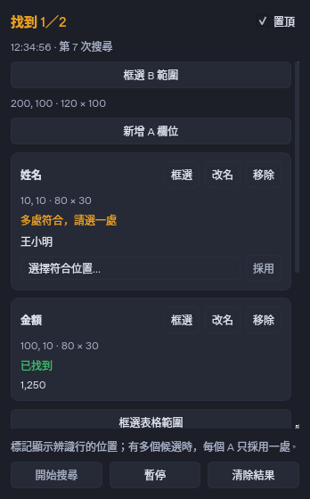
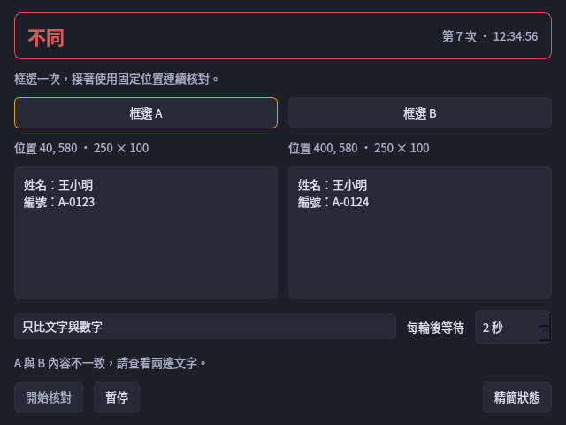

# InkPick 拾字筆

Windows 10（1809 以上）／Windows 11 的 64 位元離線文字工具。可框選螢幕辨識文字、手寫單字找候選，也能匯入 PDF／圖片，把固定位置的欄位逐頁填入文字模板，最後複製或匯出 TXT。

本版為 **1.8.0-rc.11 候選版**，延續文件套版、螢幕擷取、複製模式、手寫、歷史與檔案位置功能。EXE 包含 Python、Qt、PDFium、兩組 OCR 模型及手寫引擎；使用電腦不需安裝 Python、pip、PDF 閱讀器或 Windows 手寫語言套件，也不需連線下載模型。

本版新增「整列搜尋」：在來源表格框選同一列的多個 A 欄位，到一個 B 範圍尋找各欄文字；每個 A 最多選定一處結果。可手動換列，或校正表格的選取列底色後跟隨其他軟體換列。原有 A／B 固定位置核對、90 天自動封存、文件套版及複製模式保留。

沿用前版的套件修補與背景工作回收：手寫完成後結束輔助程序，OCR 閒置時停用 CPU 忙等。A／B 連續辨識只有在使用者開始核對後才執行。套件掃描及網路觀察的範圍見 [資安與背景工作檢查](docs/SECURITY_REVIEW.md)，設定、旁支與停用節點的掃描範圍見 [設定接線與節點稽核](docs/CONFIG_WIRING_MATRIX.md)。

## 下載與第一次執行

從 [v1.8.0-rc.11 Release](https://github.com/maotai11/desktop-ocr-tool/releases/tag/v1.8.0-rc.11) 下載：

| 檔案 | 用途 |
| --- | --- |
| [InkPick-v1.8.0-rc.11.zip](https://github.com/maotai11/desktop-ocr-tool/releases/download/v1.8.0-rc.11/InkPick-v1.8.0-rc.11.zip) | 建議使用。包含 EXE、離線操作說明、文件套版圖文說明、授權與手寫模型來源 |
| [InkPick-v1.8.0-rc.11.exe](https://github.com/maotai11/desktop-ocr-tool/releases/download/v1.8.0-rc.11/InkPick-v1.8.0-rc.11.exe) | 同版單一執行檔；PDF 引擎、模型與執行環境已包在裡面 |
| [InkPick-v1.8.0-rc.11-README.txt](https://github.com/maotai11/desktop-ocr-tool/releases/download/v1.8.0-rc.11/InkPick-v1.8.0-rc.11-README.txt) | 可單獨下載的離線操作說明，與 ZIP 內 `OFFLINE_README.txt` 內容相同 |
| InkPick-v1.8.0-rc.11-SHA256SUMS.txt | 核對同版下載檔案的 SHA256 |
| InkPick-v1.8.0-rc.11-validation-metadata.zip | 同次建置的去識別驗證摘要，不是執行必需檔案 |

1. 在可上網的電腦下載 ZIP，再用隨身碟帶到離線電腦。
2. 解壓到自己有寫入權限的資料夾，例如 `D:\Tools\InkPick`。不要直接從 ZIP 裡執行，也不要放在受保護的 Program Files。
3. 執行 `InkPick-v1.8.0-rc.11.exe`，不需管理員權限。預設縮到右下角系統匣，點拾字筆圖示開啟浮動窗。
4. 首次開啟會解開內含資源並載入模型。浮動窗顯示「可擷取文字」後，即可使用。
5. 結束程式請用系統匣的結束選項，讓尚未完成的辨識與儲存先結束。

核對檔案可用 PowerShell：`Get-FileHash .\InkPick-v1.8.0-rc.11.exe -Algorithm SHA256`，與同版 SHA256SUMS 的 EXE 那一列比對。ZIP 內的 `OFFLINE_README.txt` 與 `README.txt` 是相同的完整文字說明，可直接用記事本閱讀。

## 整列搜尋：多個 A，到一個 B 範圍找文字

例如來源表格同一列有「姓名、編號、金額」，另一個畫面有一整區資料可核對。這個模式讓多個 A 共用一個 B 搜尋區；每個 A 最多選定一處位置，找到多處時由你選，不自動挑第一筆。原有固定位置 A／B 核對仍保留在下節。

1. 讓來源第一列與 B 資料同時顯示於主螢幕。點浮動窗「整列搜尋」，或從系統匣選「整列搜尋（多 A／共用 B）」。先替預設「欄位 1」按「框選」，需要其他欄位再按「新增 A 欄位」；姓名、編號、金額都框在同一列，可改名，最多 20 欄。
2. 按「框選 B 範圍」，一次圈住所有 A 共用的可見搜尋區。A 和 B 不可重疊。所有 A 共用同一比對方式；「數字嚴格／文字近似」採固定 95% 文字相似門檻，數字片段保留正負號與格式，OCR 信心另行判斷。
3. 按「開始搜尋」查看各 A 的結果。有多處符合時，在該欄下拉選單選位置，再按「採用」；找不到不沿用前一列。數字片段嚴格保留格式：`1.23 ≠ 123`、`-100 ≠ 100`、`1,000 ≠ 1000`、`01 ≠ 1`；近似或低信心結果即使手選，也仍需確認。標示定位到 OCR 行，行內重複數字不能保證逐字定位。
4. 手動換列：設定「列高／間距」（相鄰列距，1–500 螢幕像素），按「上一列／下一列」。所有 A 框一起移動並重辨，不會替另一套軟體點選或捲頁。
5. 自動跟隨：先在來源軟體選取基準列，按「框選表格範圍」圈住可跟隨區域，再按「校正目前選取列」，在 3 秒倒數內回到來源軟體選好基準列；校正成功後開啟「自動跟隨表格」。新選取底色連續兩次檢查穩定後才跟隨；同一 Y 座標換成新內容也會重辨。

西文詞與識別碼要求完整邊界：`Ann` 不命中 `Anna`，`123` 不命中 `INV123`；中文可在行內找子字串。

控制窗可切換置頂；桌面標示點擊穿透，「標記填色濃度」可調。要改位置請回控制窗按框選，Esc 取消。擷取時暫時隱藏標示，可能短暫閃動。自動跟隨依賴一致的選取底色；多處高亮、白底、斑馬紋或超出範圍時不能可靠定位，請改手動換列或重新校正。

開窗不自動搜尋；「開始搜尋」或手動換列才啟動搜尋，校正另做一次取樣。暫停／關閉取消後續工作及標示；單次原生 OCR 需先返回。設定、位置和結果僅保留於本次執行，不寫歷史、剪貼簿、匯出或內容 Log，也不產生搜尋截圖檔。不能讀取未顯示或被遮住的文字，不會自動捲頁。完整步驟、比對規則與暫存範圍見 [整列搜尋操作說明](docs/SHARED_SEARCH.md)。



合成資料示例：姓名「王小明」有多處候選待選，金額「1,250」已找到。桌面標示依 OCR 文字行定位，不代表儲存格或字元座標。

## A／B 核對：同時查看多組結果

核對主窗預設 **348 × 560**，與原桌面浮動工具相同；「迷你」為 **320 × 300**（最小 320 × 280），仍可移動、調整大小及切換置頂。多組時，每組各有一張結果卡，同時顯示名稱、A／B 兩行文字、核對狀態與上次辨識時間。一般窗可完整看到約 3 組，迷你窗至少 2 組；更多組別直接捲動查看，不必切換「第一組／第二組」。

1. 點浮動窗「A／B 核對」，在「設定組別」選取要設定的一組，分別框選 A、B；Esc 取消這次框選。同組兩區須位於主螢幕且不能重疊。
2. 按「＋」新增組別，例如「訂單編號」「金額」，逐組設定各自的 A／B。最多 20 組、至少保留 1 組；「⋯」可「更改組名」或「移除此組」。任一組尚未選好兩區時，先完成或移除該組才能開始。
3. 把核對窗放在**所有組別**的框選範圍外，按「開始全部」。各組依建立順序核對，共用一個擷取工作者與 OCR 佇列；每組 A／B 取自同一張快照，組與組依序擷取，不代表全部組別同時取樣。
4. 結果卡會各自更新，其他組的文字、時間與捲動位置會保留。「設定組別」或點選卡片只決定要重選位置、管理或查看全文的組別，不會把其他組的結果隱藏，也不會改動正在辨識的位置。
5. 卡片**綠色「一致」、紅色「不同」、琥珀色「待確認」**，並可顯示「檢查／辨識中／未變／暫停」。空白、失敗或仍需人工核對的結果不算一致。系統匣優先顯示有差異的組別；沒有差異但仍有未確認結果時顯示待確認。

每區文字預設一行，長文省略；滑鼠停留可查看前 800 字。選定組別後按「查看全文」，在窗內閱讀完整內容；迷你模式會先還原一般尺寸，再展開全文。按「收合全文」回到摘要；新增結果不會自動放大、移動或啟用視窗。單組時仍保留原本的兩區結果版面。

每批走完全部組別後，預設等 2 秒再檢查，可調為 1–60 秒，辨識耗時另計。每組只比較自己的 A／B 像素摘要，兩區沒變就跳過該組 OCR，保留上次文字、時間與次數；只有變動的組別重新辨識。框外變化不觸發，框內游標閃爍或動畫也算變化。想重讀相同畫面時，先暫停再開始。

預設「忽略空白與標點」只比較文字與數字，也忽略其他符號；大小寫及全形／半形不自動統一。「逐字比對」會連空白與標點一起核對。**金額或負號有意義時請用逐字比對**，因為預設規則可能將 `1.23` 與 `123` 視為相同。這個規則和剪貼簿的複製清理互相獨立。

「迷你／還原」切換呈現方式，不新增辨識工作；手動拉短至高度低於 540 時也會使用迷你版面，拉高至 560 以上回一般版面。Windows 標題列最小化會隱藏視窗並繼續已啟動的核對；想保持小窗可見請用「迷你」。

新增、更名、移除組別、重選範圍或改比對規則會先暫停全部組別。關閉、暫停或退出會停止計時器，清除各組摘要與待處理影像；已進入原生呼叫的單次工作仍需返回，晚到結果會丟棄，不再補辨、處理下一區或下一組。單組一次核對超過 30 秒會暫停整批。關窗後重開仍保留本次組別，須手動開始。

組別、位置與結果僅存於本次執行記憶體，退出後需重新設定。不改剪貼簿、不寫入歷史，也不產生核對截圖或內容 Log。所有來源區域需保持可見；捲動、移動或縮放後應重選。顯示器配置變動會清除全部位置、保留組名。本版不能讀取鎖定畫面或被其他視窗遮住的原內容。




## 文件套版：PDF／圖片逐頁填入文字

適合同一版型的通知單、表格或掃描圖片。例如每頁都要取出姓名與金額，組成固定文字：

1. 點浮動窗「文件套版」，或從系統匣選「文件套版（PDF／圖片）」。
2. 點「匯入 PDF／圖片」。預設**每個檔案上限 100 MB**，可在視窗調整為 1–1024 MB；可一次選多個檔案。
3. 在第一頁的「框選欄位」分頁選「辨識1」，拖曳框出第一段文字；按「新增欄位」建立「辨識2」，再框第二段。
4. 切到「文字模板」，輸入 `文字｛辨識1}文字測試{辨識2}`。也可把欄位改名為「姓名」「金額」，按「重新命名」後使用 `{姓名}`、`{金額}`；模板中的舊名稱會同步更新。
5. 按「開始辨識」。在「逐頁核對」檢查結果；雙擊欄位或按 F2 可修改文字，包含多行內容。
6. 檢查「TXT 預覽」，按「複製結果」或「匯出 TXT」。每頁各產生一份文字，頁與頁額外用空行分隔；TXT 使用 UTF-8（含 BOM），可用 Windows 記事本開啟。

若某頁的「辨識1」「辨識2」分別是「王小明」「1,234」，上述模板會輸出 `文字王小明文字測試1,234`。模板的固定文字、標點、空格與換行會保留，不套用螢幕 OCR 的逗號／換行清理。

**後面沒重選，就沿用第一頁。** 第二頁位置不同時，切到第二頁，在「只改這一頁」範圍重新框選需要調整的欄位；第三頁未調整時仍用第一頁的位置。按「此頁套用第一頁」可清除當前頁面的所有例外位置。不同圖片尺寸依頁面比例套用，但不會自動追蹤版面移動的欄位。

框錯位置時，選取欄位再按「清除框選」：「所有頁共用」會清掉這個欄位的共用框與各頁例外；「只改這一頁」只清當前頁，該頁不會自動改用第一頁的框，需重新框選或按「此頁套用第一頁」。要換一批文件，可按「清空文件」並確認；它會清除匯入頁面、全部框選位置及結果，保留欄位名稱與文字模板，不刪原檔、不改剪貼簿。

預覽上方的「−」「＋」可縮放，「100%」切回百分之百，「適合視窗」顯示整頁；放大後開啟「拖曳移動」即可拖動頁面，關閉後繼續框選。也支援 Ctrl＋滾輪縮放及滑鼠中鍵拖動。

支援 PDF、PNG、JPEG、BMP、TIFF、WebP，每批最多 500 頁、32 個命名欄位。一般已填 PDF 表單可顯示內容；加密 PDF 請先解除密碼，XFA 動態表單請先列印或另存為一般 PDF。原始檔只讀，不會自動加入截圖歷史或另存副本。欄位、模板與結果只保留在本次程式執行中，需要留檔請先匯出 TXT。

失敗或尚未完成的欄位會阻止匯出，請先重辨或修正；匯入、辨識、停止與關閉視窗都不會自動複製。更多位置調整、錯誤處理與操作圖見 [文件套版說明](docs/DOCUMENT_TEMPLATE.md)。


## 從螢幕擷取文字

### 預設：辨識後自動複製全文

1. 點浮動窗「擷取文字」，或按 **Ctrl+Shift+O**。
2. 在螢幕上拖曳框出要辨識的範圍；Esc 可取消。
3. 等待辨識完成，這次範圍內的全文會自動複製。
4. 切回目標程式，按 **Ctrl+V** 貼上。

辨識結果與截圖照原設定保存在本機歷史。失敗、空白或已過期的辨識不會清空剪貼簿。若辨識期間已從拾字筆手寫或歷史手動複製其他內容，較早的結果只存入歷史，不覆蓋這次手動複製。

### 只想複製其中幾段

開啟浮動窗右上角設定，進入 **剪貼簿 → 辨識完成後 → 先選文字再複製**，按確定。儲存後立即生效，不需重啟。

第一步仍是框選螢幕、再進行 OCR；只改變辨識完成後的處理：

1. 辨識完成後開啟「選取要複製的文字」，預設未選取。
2. 在左側原圖點選文字框，或拖曳框選多段；Ctrl 拖曳可加選。也能在右側逐段勾選，空白鍵切換勾選。
3. 下方「複製內容」可修正文字，或反白其中一小段。按「複製」或 Ctrl+Enter，才會寫入剪貼簿。
4. 「全選」可複製整份結果；「稍後再選」、Esc 或關閉視窗都不複製。

只複製一段不會刪掉歷史中的其餘內容。取消後可從歷史開啟編輯器，再反白／複製需要的文字；沒有原圖時仍可勾選文字。選取與預覽修改不會將整份結果標為已核對。

要恢復原操作，將選項改回 **自動複製全部文字**。新安裝與沒有這個設定的舊設定檔，預設皆為全文自動複製。


### 複製時移除標點與空白

到「設定 → 剪貼簿」勾選「複製時移除所有標點與空白」，儲存後生效；預設關閉。此選項會移除 Unicode 標點，以及半形空格、全形空格、不斷行空白、Tab、換行等空白。例如 `「 您好，　世界！ 」` 會複製成 `您好世界`；原文兩行「甲 乙」「丙」會接成 `甲乙丙`。

這個選項會清理**整份複製輸出**，多筆紀錄間原本的分隔空行也會移除，結果直接接在一起；未另外勾選「移除換行」時也一樣。原有「只移除逗號」「只移除撇號」及「移除換行」仍可分別使用；只開原有「移除換行」時仍只合併同筆文字，多筆紀錄的分隔空行保留。

文字與數字會保留，數學和貨幣符號也不屬於標點。**小數點與連字號會移除**，例如 `1.23` 變成 `123`，處理金額或型號前請確認需求。清理只作用於一般 OCR／歷史的複製輸出，不修改歷史原文、手寫候選或文件套版模板；A／B 核對使用自己視窗中的比較規則。舊設定已開啟此項時，升級後維持勾選並採用新的空白清理規則。

## 截圖、手寫與歷史

- **截圖**：點「截圖」或按 Ctrl+Shift+S。是否接著執行 OCR，依「設定 → 擷取 → 截圖後自動執行 OCR」。
- **手寫單字**：點「手寫」，在方格寫一個字；停筆後顯示候選。點候選字就複製原字，再自行 Ctrl+V。「撤銷一筆」、Ctrl+Z 或「清除」可重寫。
- **穩定書寫**：候選區清空或更新時保留高度，避免畫布突然變大、讓同一筆的起點與終點移位；展開、收合及選字方式維持原操作。
- **更多候選**：原始與置中筆畫各取前 30 字，去重最多 60 字。「展開」後可捲動、用方向鍵移動及 Enter／空白鍵複製。
- **影像補辨**：手寫沒有需要的候選時，按「影像補辨」，另外用內含 OCR 增補最多兩個候選；再按一次可取消，不能保證補準缺字。
- **歷史紀錄**：浮動窗底部可開啟歷史視窗，搜尋、編輯、釘選、刪除、複製或匯出。浮動窗已移除搜尋框，Ctrl+Shift+Q 直接開啟歷史搜尋。

### 90 天自動封存

「設定 → 一般 → 自動封存」預設為 **90 天**，設為 **0／停用**可關閉，儲存後立即套用。程式啟動及每日檢查，依紀錄**最後修改時間**封存已滿設定天數的資料；不以複製或查看次數延長日期。修改文字、筆記、標籤關聯或手動還原會更新修改時間。

釘選、已刪除、已封存及辨識中的紀錄不納入。每批最多 200 筆，在資料庫工作執行緒依序處理；沒有資料時只結束這次檢查，不持續掃描。設定變更或退出會取消後續批次，關閉會等已接受的資料庫工作結束。

**封存不是刪除，也不會釋出附件占用的磁碟空間**：文字、原圖與附件仍保留，可從歷史視窗「已歸檔」分類查看，右鍵選「取消歸檔」還原。一般「刪除」仍是軟刪除、從一般清單隱藏，「清理已刪除」才會永久移除資料及其附件；使用者另存的匯出副本不跟著刪。沒有自動永久刪除或依總筆數刪除的功能。

浮窗與主控台的封存、釘選、刪除及編輯結果會同步刷新，保留主控台目前的搜尋與分類；被刪掉或不再屬於該分類的選取項目會清除。舊版異常中斷後仍標為辨識中的紀錄，缺少工作擁有者資料，不能安全地自動判定為死工作；本版保留並排除於自動封存之外，可手動重辨。

歷史視窗的「匯出」支援 TXT、CSV（Excel 相容）、JSON 與 ZIP。CSV 使用 UTF-8 BOM，包含文字、來源、OCR 狀態、信心分數等欄位，預設存入 `data/exports`；需要手動匯出才會產生。文件套版目前提供 TXT，Release 不會夾帶使用者匯出的 CSV。

| 快捷鍵 | 動作 |
| --- | --- |
| Ctrl+Shift+O | 框選並辨識文字 |
| Ctrl+Shift+S | 框選截圖 |
| Ctrl+Shift+Space | 顯示／隱藏浮動窗 |
| Ctrl+Shift+M | 開啟歷史視窗 |
| Ctrl+Shift+Q | 開啟歷史搜尋並聚焦搜尋欄 |
| Ctrl+Shift+V | 貼上最近一筆紀錄的文字 |

## 暫存、附件、產生的檔案與 Log

點浮動窗底部 **「檔案位置」** 即可開啟下列位置。「截圖與附件」及「紀錄與設定」有子選單；不存在的位置會停用。選單只開資料夾，不會刪檔，並依目前實際使用的路徑開啟。

| 選項 | 預設位置／內容 |
| --- | --- |
| 截圖 | EXE 同層 `data\captures`；原始截圖 |
| 標註附件 | `data\annotations`；圖片編輯與標註產物 |
| 縮圖 | `data\thumbnails`；歷史清單的圖片預覽 |
| 匯出檔案 | `data\exports`；從歷史匯出的檔案 |
| 歷史資料 | `data`；`app.db` 與執行中的 SQLite WAL／SHM 暫存 |
| 設定檔案 | EXE 同層 `config`；`settings.json`、備份及儲存中的暫存檔 |
| 執行記錄 (Log) | EXE 同層 `logs`；`app.log` 及按日期輪替的舊檔，最多保留 30 份舊 Log |
| 程式暫存 | 這次執行的 `%TEMP%\_MEI…`；EXE 解開的程式、模型與引擎資源，正常退出後自動清理 |
| 程式資料夾 | 目前使用的程式主資料夾 |

程式暫存與歷史資料不同：退出程式不會刪除 `data` 的截圖、附件、匯出或歷史，Log 也有獨立保留週期。請先退出程式再備份或移動資料，不要在執行中刪除 `_MEI…`、資料庫或附件。

自訂資料目錄只改變 `data` 所在位置，設定與 Log 仍跟隨程式根目錄。若曾設定 `DESKTOP_OCR_HOME`，則以該位置為根目錄。在另存對話框自行選到其他位置的檔案，仍留在當時選的路徑。


## 升級、備份與隱私

先結束舊程式，備份原有 `config`、`data` 與需要保留的 `logs`，再將新版 EXE 放回原資料夾。若換資料夾，請一起移轉 `config`／`data`。舊捷徑與自動啟動若指向舊 EXE，請更新捷徑，或在新版設定重新套用自動啟動。

- 新安裝預設**關閉剪貼簿監看**，舊設定保留。需要保存外部複製的文字時，才到「設定 → 剪貼簿」啟用。儲存監聽／文字收錄設定後立即套用；停用或暫停會卸除監聽器，重新啟用只收錄之後的剪貼簿變化，不回填目前內容。浮窗與系統匣的暫停狀態保持同步。
- 歷史、截圖、附件、匯出與 Log 都是未加密的本機檔案。不要把整份 `data`、`config` 或 `logs` 當成公開錯誤回報附件。
- OCR 與手寫不需上傳圖片或筆跡。若啟用 Windows／第三方剪貼簿同步，複製內容可能被該服務同步。
- 所有標點與空白、逗號、撇號、換行清理預設關閉，只影響複製輸出，不改歷史原文，也不作用於手寫候選原字。「所有標點與空白」會連多筆紀錄的分隔空行一起移除；單獨的換行設定則保留紀錄分隔。
- 新版公開 ZIP 排除原始 JUnit、錯誤堆疊與絕對建置路徑；公開驗證摘要不帶使用者資料夾。Repo 歷史與較早 Release 的檢查結果見 [隱私檢查](https://github.com/maotai11/desktop-ocr-tool/blob/master/docs/PRIVACY_AUDIT.md)。

## 辨識限制與離線驗證範圍

發布前會對 Linux／Windows 的實際 Python 套件清單執行 pip-audit；有漏洞、漏掃或查詢失敗即停止發布。這不涵蓋所有原生 DLL 或未知漏洞。Linux 另追蹤合成操作及其子程序的網路系統呼叫；Windows 使用同版 EXE 的防火牆阻擋測試。整列搜尋等新增路徑的覆蓋與結果，見同版 validation metadata，不沿用舊版數量作為通過證據。

手寫完成後會結束輔助程序；新筆畫會取消過期工作。系統匣、快捷鍵與載入的 OCR 模型仍保留，讓下次操作可用；剪貼簿監看預設關閉。文件按停止或清空後不再處理後續頁面，但已進入原生 PDF／OCR 的運算需先返回。要完全結束請從系統匣選「退出」。

OCR 有 PP-OCRv6 Small／Medium 辨字模型可選，兩者都已內含；Medium 較耗記憶體，不代表每字較準。請核對姓名、日期、金額與帳號。

筆畫字庫共 11,853 字，含「龘」，不含「尞、𠮷、𠀋」，也缺少「內、吳、戶、辦、嚐」等常用字。影像補辨使用另一套 OCR 字庫。候選排序與分數不是正確率，不會自動把缺字猜成其他字。

發布檢查對同次 Windows 建置的 EXE 執行 OCR、資料庫、手寫、PDF／圖片文件、啟閉與防火牆阻擋對外連線測試，並核對模型、PDFium、內嵌資源與成品雜湊。獨立資料夾、空白使用者資料與縮減 PATH 的測試用於檢查開發機依賴；仍不等於真實乾淨 Windows 10／11 的現場驗收。真人筆跡、觸控、混合 DPI 與多螢幕仍須實機核對，見 [驗證狀態](https://github.com/maotai11/desktop-ocr-tool/blob/master/docs/VALIDATION_STATUS.md)。

## 原始碼開發與建置

以下只在開發／建置機執行，離線使用電腦不需要做。Python 3.12；Windows 建置另需 Microsoft x64 C++ 編譯器，手寫 helper 使用 Release `/MT` 靜態 CRT。

```sh
python -m pip install -r requirements-dev.txt
python scripts/prepare_models.py
python scripts/prepare_handwriting_model.py
python scripts/build_handwriting_helper.py
python scripts/probe_handwriting_helper.py --report artifacts/handwriting-native-probe.json
python scripts/run_bounded_pytest.py --report artifacts/pytest-bounds.json --memory-mib 4096 --timeout 1800 -- -q
python src/main.py --self-test source-selftest.json
python src/main.py --smoke-app source-app-smoke.json
python src/main.py --self-test-handwriting source-handwriting.json
python src/main.py --self-test-handwriting-image source-handwriting-image.json
python src/main.py --self-test-documents source-documents.json
# Windows only:
python scripts/build.py
```

模型只在建置時從固定來源下載並核對 SHA256；應用程式不會在首次執行補下載。Linux 無桌面測試可設 `QT_QPA_PLATFORM=offscreen`。

技術文件：[封裝與驗證](https://github.com/maotai11/desktop-ocr-tool/blob/master/PACKAGING_NOTES.md)、[公開驗證摘要](https://github.com/maotai11/desktop-ocr-tool/blob/master/docs/PUBLIC_VALIDATION_METADATA.md)、[第三方授權](THIRD_PARTY_NOTICES.md)、[CHANGELOG](https://github.com/maotai11/desktop-ocr-tool/blob/master/CHANGELOG.md)。
