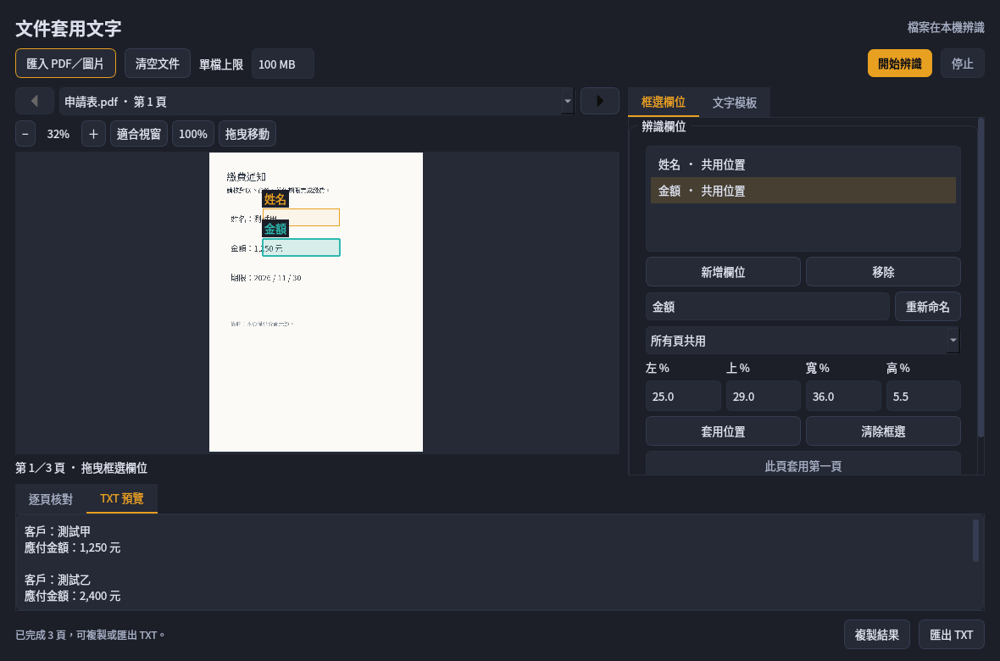
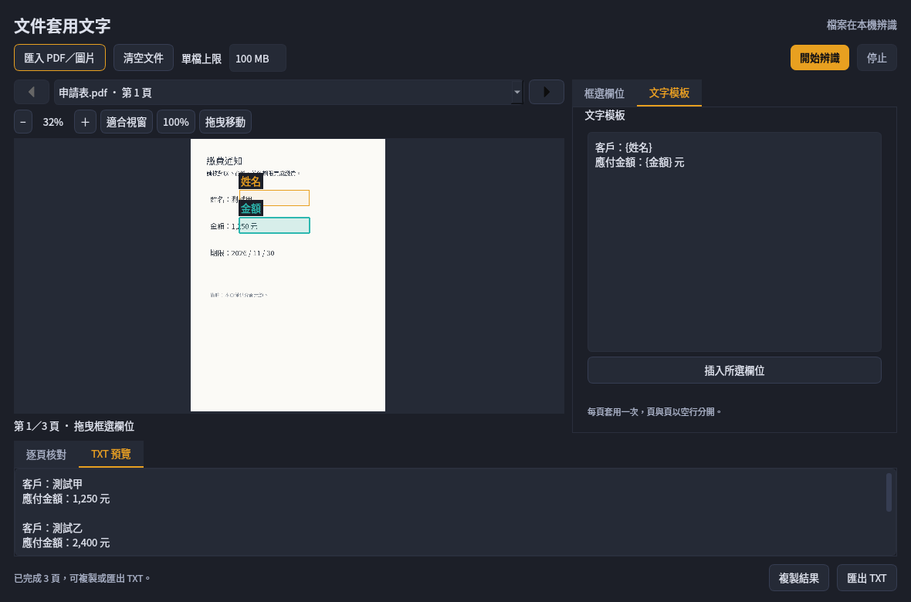

# 文件套版：PDF／圖片批次辨識

本說明對應 v1.8.0-rc.5；文件套版自 v1.8.0-rc.4 提供。檔案在本機讀取與辨識，不需要網路或另外安裝 PDF 閱讀器。適合同一版型的通知單、表格與掃描圖片：先在第一頁指定要辨識的欄位，再把每頁結果填入同一份文字模板。

## 一次設定，逐頁套用

1. 在浮動窗或系統匣選「文件套版」。
2. 點「匯入 PDF／圖片」，選擇檔案。多個檔案依匯入順序排列，PDF 內仍按原頁碼排列。
3. 在第一頁的「框選欄位」分頁選擇「辨識1」，拖曳框出第一個欄位；按「新增欄位」建立「辨識2」，再框第二個欄位。預覽上方「−」「＋」可縮放，「適合視窗」可恢復整頁顯示；也能用右側的左／上／寬／高百分比及「套用位置」設定範圍。
4. 切到「文字模板」分頁，輸入要輸出的文字，例如：

   ```text
   文字｛辨識1}文字測試{辨識2}
   ```

5. 按「開始辨識」，完成後在「逐頁核對」檢查各頁欄位，在「TXT 預覽」確認整份輸出，最後按「複製結果」或「匯出 TXT」。

若第一頁兩個欄位辨識為「王小明」及「1,234」，結果會是：

```text
文字王小明文字測試1,234
```

每一頁各套用一次模板，頁與頁之間加入兩個換行，以空行分隔。模板本身的固定文字、標點、空格與換行會保留；模板末尾原有換行時，也會一起保留。辨識完成時不會自動改動剪貼簿。

實際介面（使用合成示範資料）：





## 命名欄位

欄位可改名，例如把「辨識1」改成「姓名」、「辨識2」改成「金額」，模板就能寫成：

```text
姓名：{姓名}
金額：{金額} 元
```

先選欄位，在名稱欄輸入新名稱並按「重新命名」，模板中的同名欄位就會同步更新。同一個欄位可在模板重複出現，每頁只辨識一次再填入各處。支援 `{姓名}`、`｛姓名｝` 及混用全半形括號的 `｛姓名}`；需要固定顯示大括號時，使用雙括號，例如 `{{固定文字}}`。雙擊欄位名稱或按「插入所選欄位」，可把它插入模板游標位置。

欄位名稱不能重複或含大括號／換行。拼錯名稱、括號未成對，或引用的欄位尚未框選時，會提示修正，不會靜默產生缺欄位結果。

## 第一頁位置與後續頁面

第一頁定義共用位置，後面的頁面預設使用同一組欄位。座標依頁面比例套用，因此同一版型的不同圖片尺寸也能使用。

若第二頁的位置不同，切到第二頁，在「只改這一頁」範圍重新框選需要調整的欄位；其他欄位仍沿用第一頁。第三頁如果沒有另外框選，仍使用第一頁的位置，不會接續第二頁的例外位置。「此頁套用第一頁」會清除當前頁面所有欄位的例外位置，恢復共用位置。

後續頁面也可以選「所有頁共用」更新共用位置；已另外設定過的頁面仍保留自己的例外。位置是頁面比例，不是自動找欄位：版型移動、旋轉或內容跨頁時，仍需調整框選範圍。

## 清除框選與清空文件

框錯位置時，先選欄位，再按「清除框選」。它依目前範圍處理：

- **所有頁共用**：清除所選欄位的共用位置及各頁例外，這個欄位需要重新框選。
- **只改這一頁**：只清除當前頁的這個欄位，該頁不會自動退回第一頁的位置。可重新框選，或按「此頁套用第一頁」恢復當前頁所有欄位的繼承；其他頁不變。

清除框選後，舊辨識結果作廢；模板用到的欄位必須有可用位置，才能重新開始辨識。

要換一批文件，可按視窗上方「清空文件」並確認。匯入頁面、全部欄位位置、逐頁例外及結果都會清掉，欄位名稱和文字模板保留；再次匯入後需重新框選。原始檔、已匯出的 TXT 與剪貼簿不受影響。辨識或載入中也能清空文件，尚未完成的舊工作會取消，晚到結果不會回填新批次。

## 縮放與移動預覽

預覽上方依序顯示「−」、目前比例、「＋」、「適合視窗」、「100%」與「拖曳移動」。可用按鈕縮放，不必依賴滑鼠快捷操作；「100%」回到百分之百，「適合視窗」顯示整頁。

放大後開啟「拖曳移動」，就能用滑鼠左鍵拖動頁面；關閉後左鍵恢復框選欄位。一般滾輪與捲軸可移動頁面，滑鼠中鍵也可拖動。Ctrl＋滾輪或 Ctrl＋加號／減號可縮放，Ctrl+0 適合視窗，Ctrl+1 回到 100%。

手動縮放比例會保留到切換頁面或調整視窗大小後；使用「適合視窗」時會隨視窗重新調整。載入預覽或辨識期間，縮放與框選暫時停用。預覽放大不會增加原始文件的解析度。

## 檔案大小與處理範圍

- 單一檔案預設上限 **100 MB**，可在文件視窗調整為 1–1024 MB；設定會保留到下次開啟。大小以 1024 × 1024 bytes 計算。
- 支援 PDF、PNG、JPEG、BMP、TIFF、WebP；多頁圖片依其頁面排列。一般 PDF 表單會顯示已填寫內容；XFA 動態表單請先列印或另存為一般 PDF，加密 PDF 請先解除密碼保護。
- 單次最多 500 頁、32 個命名欄位。圖片解析度與頁面渲染另有記憶體上限，超過時會提示先縮小或分批。
- 只在需要時載入單頁，逐欄位排隊辨識；不會把整份 PDF 的所有頁面一次解成圖片。
- 原始檔案不會被覆寫，也不會自動複製到截圖歷史、產生輸入副本或上傳。檔案在處理途中被移動或修改時，請重新匯入。

## 檢查與匯出

在「逐頁核對」雙擊欄位或按 F2／Enter，即可修改這一格的文字，編輯視窗支援多行；按確定後輸出預覽會更新。需要核對的文字會保留提示。失敗或尚未完成的欄位須先重辨或修正；若某格確定應為空白，也可進入編輯視窗，保留空白並按確定，明確確認這一格。

「複製結果」與 TXT 使用同一份預覽內容，保留模板中的字元，不套用一般 OCR 複製時的逗號／換行清理。TXT 使用 UTF-8（含 BOM），可在 Windows 記事本開啟。預設另存位置為本機 `data/exports`，也可自行選擇其他路徑。

匯入、框選、辨識與取消不會自動複製文字。關閉視窗會取消目前批次；程式會等待當前無法中斷的原生運算返回後再釋放資源，不在背景繼續跑剩餘頁面。只有明確匯出的 TXT 會成為留檔，內容可能含文件中的個人資料，分享前請自行檢查。

欄位、模板、逐頁位置與結果是本次程式執行中的工作資料，不會保存為永久專案；結束程式前請先匯出需要的 TXT。重新匯入其他檔案時，會保留共用欄位與模板，但清除先前的逐頁例外與結果；單檔上限設定會保存到下次開啟。

## 常見情況

- 「開始辨識」不能按：檢查模板的欄位名稱是否存在、括號是否成對，以及每個引用欄位是否都已框選。
- 字太小或辨識不到：先縮放預覽核對框選是否切掉筆畫，調整到只包含需要的文字；結果仍需人工核對，放大預覽不會讓原始低解析圖片變清楚。
- 檔案超過上限：可調整單檔 MB 上限；若超過 500 頁或影像解析度上限，請先拆檔或縮小圖片再匯入。
- 匯入後原檔被改動或移動：重新匯入，避免把不同版本的文件套在舊位置上。
- 另存 TXT 被拒絕：選擇有寫入權限的資料夾，以 `.txt` 結尾；不能選取匯入原檔或其別名作為輸出位置。
- 已按「停止」仍未立即結束：目前正在執行的原生辨識必須先返回，之後不再處理剩餘欄位；請等待狀態更新，不要在執行中刪除輸入檔。

## 驗證範圍

以合成的兩頁 PDF 實際呼叫內含 OCR 模型，檢查繁中文字與金額能填入模板；以色塊測資檢查第一頁位置繼承、逐頁覆寫及結果不會混頁。一般 PDF 表單另有已填／空白欄位對照，檢查填寫內容可顯示，且原檔未變更。這些測資不代表任意文件的辨識準確率。

`--self-test-documents` 檢查 PDFium／圖片渲染、位置與模板規則，使用純合成頁面，不讀使用者資料。Windows 發布檢查會在 EXE 被阻擋對外連線時重跑，並將單一 EXE 放入空白設定、清空 Python／Qt 環境變數、只保留 Windows 系統 PATH 的環境再驗證，檢查 PDFium 隨成品封裝。報告須對應同一份 EXE 的雜湊；來源測試、隔離測試及重試不代替獨立乾淨 Windows 10／11 實機驗收。

若某次檢查逾時，該次不視為通過；後續重試必須依同版成品與實際工作流程紀錄判讀。最終狀態以同版 Release 的驗證摘要及 [驗證狀態](https://github.com/maotai11/desktop-ocr-tool/blob/master/docs/VALIDATION_STATUS.md) 為準，不沿用其他版本的成功結果。
