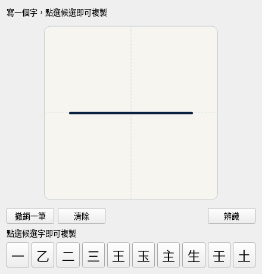
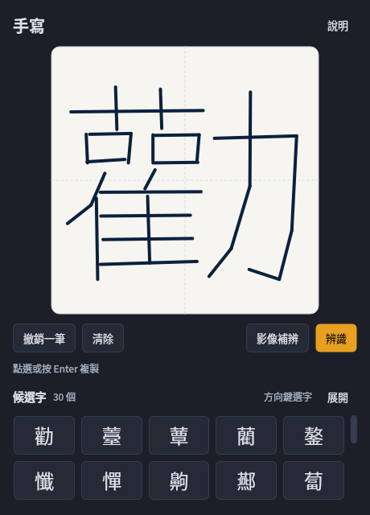
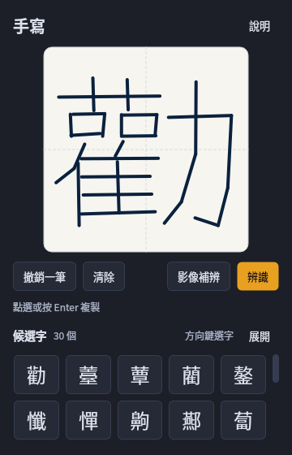
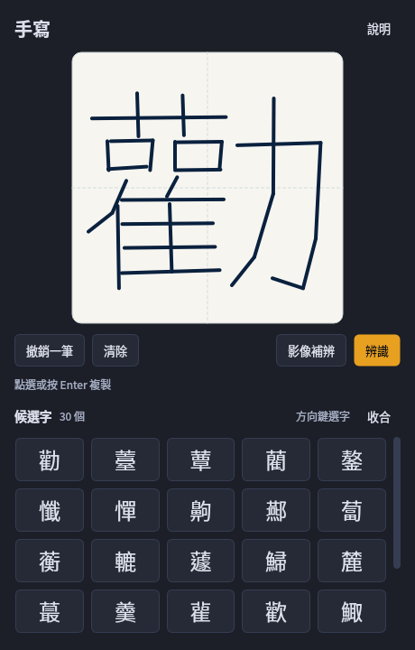

# 手寫與原生介面改善紀錄，2026-10-15

本紀錄對應本地工作樹，尚未重新產生 Windows 成品。它證明根因與工程行為，不是「真人手寫已辨準」的證明。

## 結論與範圍

- 原先候選被 Python／C++／204-byte reply 同時硬限10。獨立Top30 adapter的1536案前10字與分數完全一致；候選增多本身沒有改善Top1。
- Zinnia 特徵含絕對座標、筆順、方向；沒有字框置中／尺度正規化。小字偏角落會嚴重失配，反轉筆順也會失配。
- 模型11,853字，每字僅一份原始筆跡。binary、alphabet與XML字集一致，但缺少內／吳／戶／辦／嚐等常用字；Python Big5 CJK集合13,061字中有1,208字未收錄，不能把這個編碼集合當成教育部常用字測驗。
- 內含PP-OCRv6 Small rec字表18,708字，能輸出上述常用字，但又缺少1,212個Zinnia字，包括龘。兩者互補，不可互相整體取代。字表含字也不代表實際筆跡能辨準。

## 有界對照

輸入在推論前固定：128字，按SHA256(seed+label)選取，六種筆跡狀態乘raw／bbox兩種處理，共1536案。所有筆跡源自上游模型訓練XML；位置、尺度、筆順、方向擾動是壓力測試，並非真人樣本。

- XML SHA256：85ab37c56bcb14a54a7ae106f2504b6505cf6c9917ca8c636312153fd9d00e53
- 封存輸入 SHA256：6b20393f4a5572c1b41c547910069870577715af80ebdb2a6b8282a9bbca9e7c
- seed：InkPick-geometry-stress-v1-fixed-before-inference
- bbox固定最長邊800、中心500，維持長寬比；沒有按預期字調參
- 重建輸入：`python scripts/prepare_handwriting_stress_inputs.py --output <獨立目錄>`，不下載、不推論，也拒絕覆寫不同封存輸入

每組128案，數值為預期來源字出現的案數：

| 狀態 | raw Top1/10/30 | bbox Top1/10/30 |
|---|---:|---:|
| 原始來源 | 128/128/128 | 128/128/128 |
| 小字置中 | 123/127/127 | 128/128/128 |
| 小字左上 | 0/26/54 | 128/128/128 |
| 小字右下 | 1/49/75 | 128/128/128 |
| 反轉筆順 | 0/7/9 | 0/5/8 |
| 每筆反向 | 24/53/69 | 21/48/61 |

bbox不能粗暴取代raw：每筆反向時Top1有2案新增命中、5案失去命中，Top30有1案新增、9案失去。現在保留raw前10，其餘按固定順序交錯並去重，保留兩路Top30與每字來源／各路rank。不做不同引擎原始score加總。這保護候選可達性，但也保留了小字偏角落的Top1問題；排序品質仍待解，不能以union recall冒充準確率。

同一輸入的固定256px黑筆白底raster交內含Small rec，一次只載一個rec session；1536輸入得到1394份唯一raster。各組exact單字命中48%–52%左右，沒有做簡繁轉換、字串清理或事後挑樣。這支持「可研究互補」，不支持「缺字已補準」。完整機器可讀摘要及固定選字見 [20261015-summary.json](handwriting-evidence/20261015-summary.json)。

native對照有timeout／CPU／記憶體上限，兩次helper各約21秒、RSS約55MiB；raster約36秒、RSS約142MiB。所有assessment子程序均退出/reap。Linux來源碼結果不能代替Windows EXE資源與生命週期驗收。

## 本地實作

- 協議v2：每路30、雙路最多60、嚴格UTF-8／字表／finite score／generation／size；新舊helper不混用。bundle lock、build/probe/inspector同步要求v2。
- 手動「影像補辨」：同EXE早期worker模式，START/Job後才載固定Small rec；raw／bbox各做一張圖，最多兩個單一CJK候選，保留筆畫候選及來源。沒有多字拆猜／簡繁轉換；再按一次取消，改筆跡或關閉也退休並終止。worker完成即退出。
- image READY回報PID，必須等於QProcess PID，避免onefile父／子程序假設未成立時守錯程序。Windows windowed管線、Job、父退出及實際PID仍需同成品測試。影像功能smoke要求固定「一」control有輸出，避免全數濾空卻算通過；這只證一份已知control可用，不是普遍準確率。
- 清除、重畫、undo、cancel、較新辨識、close/reopen後，舊請求的候選與非fatal錯誤不能改變新狀態；整體helper崩潰仍須歸最新pending顯示失敗。

## 原生UI可視驗收

設計參考的是元件與互動內容，不只首頁：[oil-ui](https://github.com/oil-oil/oil-ui/blob/main/README.en.md)、Impeccable [typeset](https://impeccable.style/docs/typeset/)／[layout](https://impeccable.style/docs/layout/)／[distill](https://impeccable.style/docs/distill/)、shadcn [Button](https://ui.shadcn.com/docs/components/button)／[ScrollArea](https://ui.shadcn.com/docs/components/scroll-area)／[Collapsible](https://ui.shadcn.com/docs/components/collapsible)、[Beautiful UI互動案例](https://www.beautifului.dev/)。原架構維持PySide與離線原生元件。

- Typography：20px標題、14px候選區標題、13px控制、12px狀態、24px候選字；不讓説明搶主操作。
- Composition：16px外距、8px網格間距、白書寫面是主操作，工具列緊湊且按鈕同高36px；辨識為唯一主色按鈕。
- Density：移除常駐重複引導；説明按需開啟；複製用短暫可見回饋。五欄候選、收合兩排、可捲／可展開，不靠單列微小字按鈕塞滿。
- Components：候選至少48px高、hover／pressed／focus／copied一致；Tab與方向鍵導航，Enter／Space確認，焦點捲入可見區；360px窄窗與540px短螢幕不硬撐超高，必要時工作區可捲。

鍵盤規範參考 [Windows keyboard accessibility](https://learn.microsoft.com/windows/apps/design/accessibility/keyboard-accessibility) 與[繁體中文IME候選互動](https://support.microsoft.com/en-gb/windows/hardware/input-devices/microsoft-traditional-chinese-ime)。Linux headless Qt有實際render與geometry、鍵盤及clipboard測試；不等同Windows高DPI／觸控實機驗收。

## 上游可行性與限制

Zinnia 的 online handwriting 指筆畫序列輸入，不代表需要網路。[Tegaki官方bootstrap說明](https://github.com/tegaki/tegaki/blob/master/tegaki-models/tegaki-zinnia-traditional-chinese/README.bootstrap.txt)也明示混合筆順／寫法可能產生不合適模型，並使用BIG5／繁中／每字最多一份樣本的生成設定。

- [HanziLookupJS](https://github.com/gugray/HanziLookupJS)：有字框正規化與substrokes/DTW，不是已證實更準的繁中替換品；code/original data為GPL，MMAH資料另為Apache。
- [hanzi_lookup Rust](https://github.com/gugray/hanzi_lookup)：LGPL-3.0，內含9507字MMAH資料；繁中覆蓋與候選品質需獨立測量。
- [ctegaki-lib](https://github.com/asdfjkl/ctegaki-lib)：有筆順／筆數容錯設計，但附資料以日文／常用漢字為主，Windows未保證；不是可直接換上的完整繁中字庫。
- [Traditional-Chinese-Handwriting-Dataset](https://github.com/AI-FREE-Team/Traditional-Chinese-Handwriting-Dataset)：規模大、含上游資料，CC BY-NC-SA 4.0且可能與Tegaki重疊；沒有下載或納入產品。
- [Paddle官方Small rec卡](https://huggingface.co/PaddlePaddle/PP-OCRv6_small_rec)：描述手寫／繁中能力，但官方benchmark不能轉算成本工具準確率。

## 交付前仍缺的證據

1. 未用來調參、預先固定預期字的真人滑鼠／觸控筆樣本，尤其缺字常用字、小字、偏位、倒筆順；Top1/10/30分開報告。
2. 同一新版Windows x64 EXE／ZIP的MSVC／helper v2／frozen UI與新image worker gate；OS封鎖外連仍成功、無Python與模型快取的乾淨Windows、Job父退出與windowed pipe。
3. Windows混合DPI／短螢幕／多螢幕／實體觸控與可見focus；不能只看headless geometry。
4. raw前10固定策略的排序問題；不能用更多候選或字庫有字替代使用者想要的辨識準確。

本輪不push、不tag、不release；既有模型與授權bytes未改，沒有新模型／套件下載。

## 實際Qt畫面

下列是原生Qt實際render，非設計稿。舊圖使用UI fixture；新圖使用第一份預先封存訓練筆跡「勸」與真引擎原始Top30。它們只比較排版／互動面積，不可用作辨識品質前後比較。

原介面，440px：

新版，460px與360px，真Top30可捲動：

展開增加可見列數，完整候選仍可捲達：

