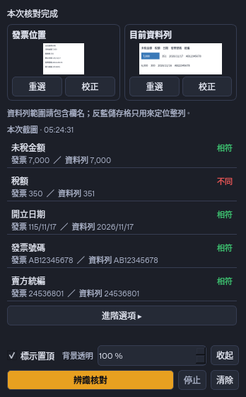
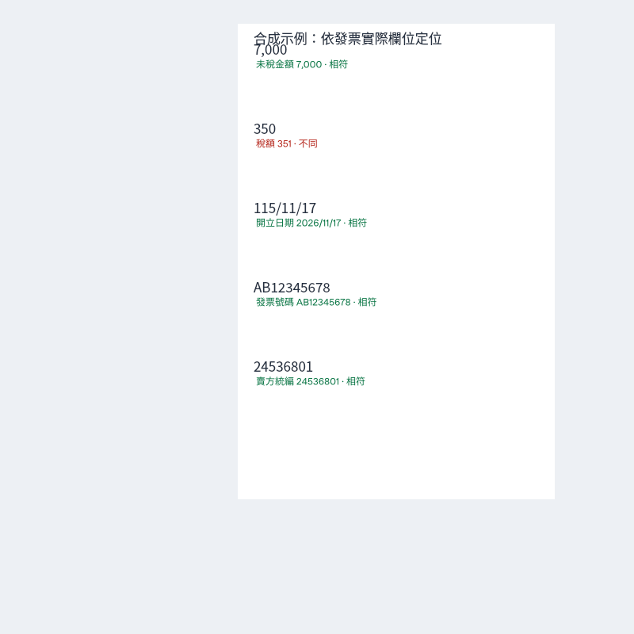

# 發票核對：一次只核對目前資料列

這是手動工具。左邊框出發票，右邊框出來源軟體的表格（含欄名），再在來源軟體選中要核對的一列。按「辨識核對」才擷取與辨識，不會定時掃描、切下一列或自動貼上。

## 操作

1. 點主浮窗的「發票核對」。首次開啟沒有自動辨識。
2. 在「發票位置」按「框選」，選中主螢幕上的整張發票。在「目前資料列」按「框選」，範圍包含欄名及可見資料列。
3. 點「收起」，回來源軟體選取資料列中的一個儲存格。反藍只用來定位所在整列，不代表讀取剪貼簿；鄰近列不會一併核對。
4. 點小工具「辨識核對」。它保留來源軟體的焦點，按這一次才重新擷取兩邊畫面。辨識期間又換畫面、改選列或停止，舊輪結果不會套回新畫面。
5. 看發票原位置旁的標示：綠色「相符」、紅色「不同」、黃色「待確認」。標示位置依本次 OCR 文字框決定；沒有可信位置、會互相遮擋或螢幕空間不足時，回「設定」查看該欄，不會憑固定發票模板猜位置。
6. 換下一列或下一張發票後，再按一次「辨識核對」。框選位置維持本次工作階段設定；來源視窗移動、縮放或切換螢幕後請重選。

以上均為合成資料的實際介面，不含使用者文件。

## 核對哪些欄位

固定核對五項：金額、稅額、開立日期、發票號碼、統編。預設金額是「未稅金額」、統編是「賣方統編」；「進階選項」可改成「總金額」或「買方統編」。兩邊必須比較同一種欄位，不能把未稅金額與總金額混為相符。

日期可辨識已支援的民國／西元格式並換算同一天，例如民國 115/11/17 與西元 2026/11/17。缺字、無效日期、歧義年制、低信心或缺少欄位會保留「待確認」，不靠模糊字串相似度給綠色結論。統編與發票號碼也須保留足夠且一致的欄位證據。

預覽的「校正」可指定欄位位置；表格校正還可指定標題列及資料列備用範圍。備用資料列只在確定沒有可用反藍選取時使用；多列、不明藍色或選取移到其他位置時會要求重新選定，不能用舊備用位置覆蓋警告。按「套用校正」後，仍須再按「辨識核對」才重新取圖。這些設定與區域只留在本次工作階段，不寫入個人文件位置。

校正時請包含完整文字，周圍留少許空白。若整張辨識將欄名與數值連在一起，或已校正欄位仍缺值、待確認，本輪會用同一個引擎補讀您指定的範圍；每欄最多一次、兩邊合計最多十欄，不會持續循環。低信心、相互矛盾或文字碰到裁切邊界時仍保留「待確認」，不為了顯示相符而清除警告。一般 OCR 與文件套版的辨識方式不受此補讀影響。

## 標示、停止與隱私

「標示置頂」預設開啟，適用文字標示及核對小工具；設定視窗仍可正常編輯。「背景透明」只調整底板，100% 不顯示底板，文字仍清楚可見。要操作來源表格可先「收起」，也能在小工具按「設定」回來調整。高縮放或較矮的螢幕會改用可捲動內容，底部的核對、停止與收起按鈕保持可操作。

「停止」取消本輪並清除過期標示；「清除」清掉核對內容。關閉或退出後不會由晚到的擷取／辨識回覆重新開啟。發票畫面、表格畫面與結果只在記憶體，核對本身不新增歷史、截圖、附件、log 文字或剪貼簿內容。

目前支援主要螢幕，兩個範圍的合併擷取最多 600 萬像素。不可把一次示範相符當成所有發票格式、手寫字或外部軟體皆可正確辨識；請核對原文，辨識不清就重新框選或校正。

## 資源與既有資料

本版以十進位 1 GB（1,000,000,000 bytes）作為實際資源門檻。記憶體檢查涵蓋程式與其輔助程序；磁碟涵蓋 EXE、活動中的解壓目錄、模型、設定、管理資料、歷史及 log。原始匯入檔與使用者另存到管理目錄外的文件不是永久管理資料；另存當次仍會預留新增檔案空間。

磁碟不足時先阻擋新寫入，不擅自刪除舊資料。可從主浮窗「檔案位置」整理自己要保留的歷史與檔案；舊資料已超限時，能安全開啟的資料庫採唯讀。log 改為每份上限 512 KiB、最多三份輪替備份。

一般 OCR 的多切片路徑可在同次操作內重用完全相同影像的讀字結果，每個實際位置仍各自保留；最多處理 512 個文字區塊，原生辨識寬度累計上限維持 65,536。暫存只含有界的雜湊與結果，取消、錯誤或結束即清空，不保留圖片，也不改一般整圖重試流程。

同版 `resource-budget.json` 會記錄 Windows EXE 冷啟動、三輪真模型核對、影像 helper，以及依序執行的一般 OCR 600 萬像素、發票長幅 600 萬像素與近方形發票輸入的實測峰值；最後一項覆蓋發票辨識的最大 400 萬像素畫布。採樣 RSS、private allocation 與 Windows Job 原生峰值分列；20 ms 是每輪要求的等待時間，報告另列實際採樣間隔的最小、最大、平均、中位數及第 95 百分位，包含檢查與系統排程造成的延遲。這些實測不是模型檔案大小，也不等於任意電腦、任意輸入的完整保證。未取得同版通過報告前，不宣稱成品已達標。

## 模型選擇

本版仍使用已內附的 Small／Medium ONNX 模型，手動發票核對的實際資源驗證採 Small。參考 [數位產業署 api-ocr-2025](https://github.com/adi-gov-tw/api-ocr-2025) 的發票欄位整理方向，自行實作台灣發票欄位及日期核對規則；沒有把其 Llama 服務搬進 EXE，也沒有新增 TrOCR＋Breeze、xReadable 大型權重、QR 解碼器或訓練資料集。一般 OCR 的人工候選來自既有整圖重試，不是新模型，也不宣稱準確率因此提高。
