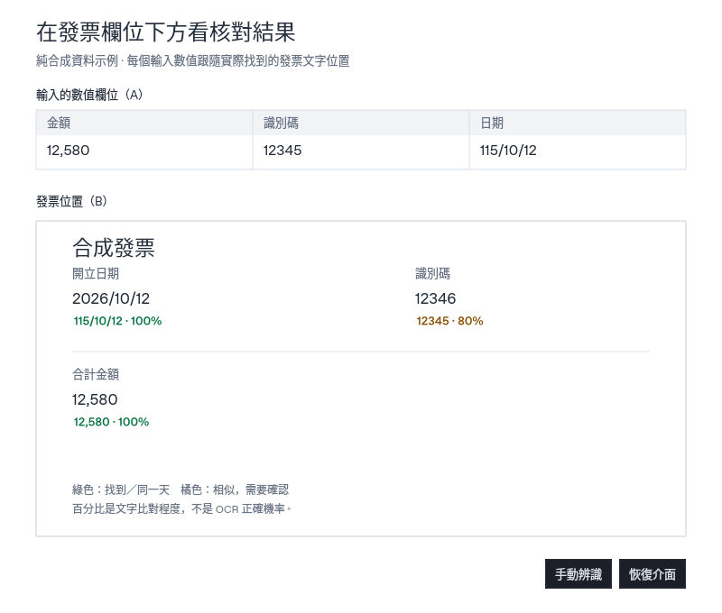

# 整列搜尋：輸入數值對照發票位置

A 是來源軟體同一列的「輸入數值欄位」，例如金額、識別碼、日期；B 是一次框選的「發票位置」。工具先取得發票的 OCR 文字與位置，再逐欄尋找 A 的數值。每個欄位最多選定一個發票位置；不同欄位可以使用同一候選，重複候選則由使用者選擇。

開始後控制窗收起，在各個**實際命中的發票文字下方**顯示 A 的數值與比對百分比。位置取自當次 B OCR 文字框，隨發票內容移動；沒有預設某張發票的欄位座標。原有固定位置 A／B 多組核對仍保留，切換模式會先暫停目前模式。

## 第一次設定

1. 讓來源第一列與發票同時顯示於主螢幕，控制窗移到讀取範圍外。點浮窗「整列搜尋」，或系統匣的「整列搜尋（數值核對發票）」。
2. 在「輸入的數值欄位（A）」按「框選數值」，只框該列的一個值。按「新增數值欄位」加入同列其他值；可改名、移除，最多 20 欄。
3. 按「框選發票位置（B）」，一次圈住要搜尋的可見發票內容。所有數值共用這個發票範圍，A 與 B 不可重疊。
4. 預設「數值核對／相似提醒」，並開啟「日期換算（民國／西元）」。若要保留每個字元直接比較，選「逐字完全相同」，此時不啟用近似與日期換算。
5. 按「開始搜尋」。文字標示出現在選定的 B OCR 文字框下方；要選候選、改位置或暫停，按「恢復介面」回到控制窗。

每個保留的 A 都要先框選，且應位於同一資料列；下一列時會一起移動相同距離。B 必須可見，工具不能讀到被遮住、最小化、捲動區外或螢幕外的內容。框太小、範圍過大或相距太遠會拒絕擷取。這裡使用現有 OCR 的文字行位置，沒有新增表格結構模型，也不會自動辨識合併儲存格。

## 找到、相似與百分比

| 結果 | 意義與處理 |
| --- | --- |
| 綠色「找到」 | 文字／數值相符，或已支援的日期換算為同一天；OCR 沒有待確認訊號 |
| 橘色「相似／需確認」 | 只有近似候選，或辨識信心／搜尋完整性仍需核對；人工採用位置也不會把近似改成確定命中 |
| 紅色「未找到」 | 沒有符合候選；不沿用前一列位置 |
| 「多處符合」 | 有多個可能位置；回控制窗選一處，再按「採用」，不自動挑第一筆 |

百分比是 A 與候選的比對程度，**不是 OCR 正確機率，也不是金額的數值誤差比例**。同樣顯示 100% 的文字若 OCR 低信心，仍可能是橘色待確認；要連同顏色與完整結果判讀。畫面最多顯示一位小數並向下截斷，避免近似分數被四捨五入成 100%。

數字近似只用於一個十進位數值片段：至少兩位數字、位數相同、正負號／貨幣符號／括號／小數點／千分位／百分號等格式相同、前導零數量相同，且只差一位數字。比對百分比為「相同數字位數 ÷ 全部數字位數」，標點與格式符號不算入分母。

| A 輸入值 | 發票候選 | 結果 |
| --- | --- | --- |
| `12345` | `12345` | 100%，符合且 OCR 無待確認訊號時為找到 |
| `12345` | `12346` | 80%，相似，需確認 |
| `12` | `13` | 50%，相似，需確認；不代表高度接近 |
| `1,234.50` | `1,234.51` | 5/6 相同，畫面顯示 83.3%，需確認 |
| `1.23` | `123` | 格式不同，不列為數字近似 |
| `-100` | `100` | 正負號不同，不列為數字近似 |
| `1,000` | `1000` | 千分位格式不同，不列為數字近似 |
| `01` | `1` | 位數／前導零不同，不列為數字近似 |

有確切符合或合法日期等價候選時，優先採用這些候選，不讓較弱的近似干擾。多個確切位置仍需選擇；唯一的近似候選可以顯示位置，但保持橘色待確認。

一般文字保留既有 95% 近似門檻：先統一 Unicode 等價組合（NFC），忽略一般文字的空白標點，保留大小寫與全形／半形差異。西文詞與識別碼要求完整邊界：`Ann` 不命中 `Anna`、`123` 不命中 `INV123`；中文可在行內找子字串。數字不把 O／I 猜成 0／1，也不套用一般複製的標點清理設定。

## 民國／西元日期

預設開啟「日期換算（民國／西元）」。例如 A 的 `115/10/12` 和發票的 `2026-10-12` 代表同一天，顯示 100%，控制窗註明「日期換算」。仍保留兩邊原文；低 OCR 信心不因換算而變成確定命中。取消勾選可停用換算；「逐字完全相同」模式也會停用換算。

支援範圍：

- 「民國／中華民國」（也接受「民国」）後接 1–3 位且大於 0 的年；未寫年制的三位年視為民國，不能以前導 0 開始。
- 「西元／公元」或未寫年制的四位年視為西元，不能以前導 0 開始。
- `Y/M/D`、`Y-M-D` 或中文年月日，例如 `115年10月12日`；月份與日期各 1–2 位，必須是有效日期。
- 支援全形數字、斜線、連字號，以及已知中文年制後的冒號，例如 `民國：115/10/12`、`西元:2026/10/12`。

不猜未標年制的一／二位年、缺年月日、無效閏日或錯字；也不把時間、日期區間、嵌入識別碼、農曆、前紀元、AD／BC／ROC 等英文年制或年制括號當成可換算日期。上述不支援的年制前綴不會丟掉後硬套支援格式。

## 發票上的文字與透明度

上圖由合成 OCR 文字／位置經實際比對與 Qt 元件繪製，不包含使用者發票，也不是模型準確率或 Windows 原生置頂驗收。

標示只顯示 A 原值及百分比，貼在已選定 B OCR 文字框的正下方；維持文字點擊穿透，可操作下方文件。文字較長會省略，完整內容在控制窗。OCR 只給文字行時，位置也只精確到那一行，不能保證指出同一行重複數字中的某一個。

若尚未選定候選、找不到、標示會重疊其他已選定的文字框或標示，或 B 範圍內下方沒有空間，就不憑空放一個位置；「恢復介面」會提示未展開筆數，可回控制窗查看。

「標示背景透明度」範圍 0–100%，預設 100%：背景全透明，只保留清楚的數值與百分比；0% 使用白底。它只改標示底板，不把文字一起變透明，不觸發新辨識，也不會因調整設定恢復已暫停的結果。

「標示置頂」預設開啟，控制文字及「手動辨識／恢復介面」兩個小按鈕；控制窗保持一般視窗。切回來源程式或擷取恢復後依原設定維持置頂，不需重開。要暫停先按「恢復介面」，再按「暫停」。

## 自動輪次與手動辨識

開始後會按設定間隔擷取畫面，檢查內容是否改變。A、B 全部未變時略過 OCR；B 未變而 A 換列／內容改變時，保留一份有界的 B OCR 記憶體快取，只重新辨識 A。快取仍核對像素與辨識設定，不把相同座標當成相同內容。

搜尋中可直接按浮動「手動辨識」，或控制窗同名按鈕：保持座標，撤銷舊一輪，重新辨識發票 B 及 A，即使畫面沒變也重新讀取。快速重複按不另開並行模型，過期回覆不覆蓋新結果。暫停／關閉時手動辨識不可用，不會暗中重新開始。

每次擷取前同時隱藏標示與兩個浮動按鈕，避免 OCR 讀到自己；恢復時可能短暫閃動。透明或置頂不能讓工具讀到被其他軟體遮住的原文。

## 手動換列與選取列跟隨

「列高／間距」是相鄰兩列的垂直距離，1–500 螢幕像素，初始 30。按「上一列／下一列」，所有 A 框一起移動並重新搜尋；B 位置保持。這只移動讀取框，不替其他軟體點列或捲頁。手動換列會暫停自動跟隨；超出範圍不沿用舊結果。

自動跟隨步驟：

1. 在來源軟體選取基準列，保持清楚、均一的選取底色，並框好同列各 A 與發票 B。
2. 按「框選輸入表格（換列用）」，只圈可跟隨的來源表格，避開工具列、固定標題及同色面板。
3. 設定列高，按「校正目前選取列」，在 3 秒倒數內回到來源軟體選好基準列。
4. 開啟「自動跟隨表格」再開始搜尋。新底色列連續兩次檢查穩定後，A 框一起跟到新列；同一 Y 座標換入新內容也會更新。

這是畫面底色追蹤，不讀取其他軟體的資料庫、控制項或語意游標。底色消失、多個可能選取列或越界時不猜位置；白底、斑馬紋、多重選取、動畫、主題改色或不等高列可能無法可靠跟隨。改用手動換列，或重新框選／校正。無法確認新列時仍按間隔檢查；要停止等待請按暫停或關閉。

來源改縮放、移動欄位或改變列距後，請重新確認位置與列高。新增／移除欄位、改框或改列高會撤銷先前校正。要處理下一頁，先在來源軟體操作，必要時重新框選。

## 停止、暫存與保留資料

開窗不自動搜尋；開始或手動換列才啟動，校正另做一次取樣。暫停、改框、清除或關閉停止後續工作、取消排隊並清除過期標示；已進入原生 OCR 的單次呼叫需先返回。晚到回覆不能重開視窗。關閉後不在背景繼續跟隨。

模式共用既有離線 OCR 工作者，不另開模型。每輪取包住已選範圍的共用快照，再於記憶體裁出 A／B；範圍間畫素可能短暫存在，不留檔。結果發表前再次檢查畫面，內容變更就丟棄該輪。

座標、校正、結果與有界快取只留本次執行記憶體，當輪影像完成／取消後釋放。不把 A／B 圖片或文字寫入歷史、剪貼簿、匯出、內容 Log 或新截圖檔，也不上傳。不提供跨次啟動的配置復原；一般 OCR 歷史、90 天封存及 Log 規則維持原樣。

找到相同字串或同一天，仍不保證原始資料輸入正確。實際同版驗證範圍見 [驗證說明](VALIDATION_COVERAGE.md) 與 Release 的 validation metadata。
