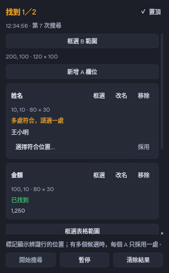

# 整列搜尋：多個 A 欄位，到一個 B 範圍找位置

這個模式適合來源表格一列有「姓名、編號、金額」，另一個畫面列出可比對的資料。先在同一列框出多個 A 欄位，再框一個共用 B 搜尋範圍。每個 A 各自顯示結果，最多選定一個 B 位置；重複候選由使用者選擇。原有每組 A 對一個固定 B 的核對模式仍保留；切換模式會先暫停目前模式，切回後須再按開始。

合成資料示例，使用實際 Qt 控制窗呈現。姓名「王小明」出現多處候選，需選一處；金額「1,250」已找到。桌面標示依 OCR 文字行定位，不代表儲存格或字元座標。

## 第一次設定

1. 在要讀取的軟體顯示第一列資料，讓來源列和 B 資料同時可見。本版先限主螢幕；將拾字筆控制窗移到來源範圍外。
2. 點浮動窗「整列搜尋」，或從系統匣選「整列搜尋（多 A／共用 B）」。先替預設「欄位 1」按「框選」，只框該列該欄內容；需要其他欄位時按「新增 A 欄位」，再框姓名、編號或金額等。可改名或移除，最多 20 個 A 欄位。
3. 按「框選 B 範圍」，一次圈住要搜尋的可見內容。B 是大家共用的搜尋區，無須為每個 A 重選，且不可與任何 A 重疊；內容必須在畫面上，無法搜尋捲動區外或被其他視窗蓋住的文字。
4. 選擇比對方式，全部 A 共用同一規則；「數字嚴格／文字近似」採固定 95% 文字相似門檻，數字片段保留格式。相似度和 OCR 信心是兩個不同指標，詳見下節。
5. 按「開始搜尋」。每個 A 分別列出自己的文字、結果及 B 候選；多個候選時，在該欄下拉選單挑一個位置，再按「採用」。

開始前每個 A 都必須框選；不用的欄位請移除，至少保留一欄。A 的框必須對應同一資料列，後續換列時會一起移動相同的垂直距離。框太小、範圍過大或彼此相距過遠會拒絕擷取，請縮小 B 或把來源畫面拉近。它不會從不規則表格自動推斷欄位或合併儲存格，也沒有接入新的表格結構模型。

## 數字與文字規則

「數字嚴格／文字近似」先統一 Unicode 等價組合（NFC），文字忽略空白標點，但保留大小寫及全形／半形差異。數字片段另用嚴格規則，保留正負號、小數點、千分位、百分號及前導零，不把 `O／I` 猜成 `0／1`，也不套用一般複製的標點清理。

西文詞與識別碼要求完整邊界：`Ann` 不命中 `Anna`，`123` 不命中 `INV123`；`Ann` 可命中 `Ann-Marie` 或空白分隔姓名中的 `Ann`。中文允許行內子字串，但框線仍只精確到 OCR 文字行。

| A | B | 判斷 |
| --- | --- | --- |
| `1.23` | `123` | 不相同 |
| `-100` | `100` | 不相同 |
| `+100` | `100` | 不相同 |
| `1,000` | `1000` | 格式不同，不相同 |
| `01` | `1` | 前導零不同，不相同 |

這裡保護數字的字面格式，不是將金額自動換算成同值。選「逐字完全相同」時保留所有字元，停用近似搜尋；全部 A 共用這個模式，沒有逐欄數字／文字開關。

文字相似度衡量「A 文字和 B 候選文字有多接近」，門檻固定 95%；OCR 信心衡量引擎對自己讀字結果的把握。達到 95% 門檻不代表 OCR 高信心，也不能把錯字保證變正確。綠色「已找到」才是已選定的確定命中；紅色「未找到」表示無符合行，琥珀色「多處符合，請選一處」或「需要確認」則不能當成確定命中。近似候選歸在需要確認，多個位置符合時不自動選第一個。

同一個 A 最多採用一處位置，候選列表不等於已確定匹配。近似候選即使只有一處或經人工採用，仍維持需要確認；A 或 B 原始 OCR 為待核對時，也不因選定位置就變成確定命中。桌面標示以 OCR 行為單位，不能假裝精確指出同一行重複數字的哪一個；先看原文與狀態再採用，找不到不沿用上一列標示。

## 手動換列

在「列高／間距」輸入相鄰兩列的垂直距離，單位是螢幕像素，可設 1–500，初始 30。這是列與列的間距，不是 A 框本身高度。

按「上一列」或「下一列」，所有 A 框會按列高一起移動，並重新搜尋。這些按鈕只移動本工具的讀取位置，不會替另一套軟體點選資料列或捲頁。手動換列會暫停自動跟隨；超出可用範圍時不繼續移動或沿用舊結果。

來源軟體若改縮放、移動欄位、展開不等高列或捲動後改變版面，請重新框選並確認列高。新增／移除 A、改框或調整列高會撤銷先前校正，自動跟隨前需重新校正。

## 跟隨另一套軟體的選取列

1. 在來源軟體選取要當基準的一列，保持清楚、均一的選取底色；先完成同列各 A 欄位及 B 的框選。
2. 按「框選表格範圍」，只圈住可跟隨的表格區域，避開工具列、固定標題及其他同色面板；設定正確列高。
3. 按「校正目前選取列」，在 3 秒倒數內回到來源軟體選好基準列。校正成功後，以有底色的一列和 A 欄位置建立基準。
4. 開啟「自動跟隨表格」後開始搜尋，再回到來源軟體點選其他列。新選取列連續兩次畫面檢查都穩定後，A 框會一起跟到新列，重新讀取內容並搜尋 B。

這是辨識使用者所圈表格中的選取底色，沒有讀取其他軟體的資料庫、控制項或語意游標。底色消失、同時有多個可能選取列或超出表格範圍時，不把猜測當成新列。白底、斑馬紋、多重選取、動態動畫、主題改色或不等高列可能無法可靠追蹤，應改用手動換列或重新校正。無法確認新列時仍會按間隔檢查、等待穩定，不等於已暫停；要停止等待請按「暫停」或關閉。

同一個螢幕 Y 座標捲入新的資料時，也會重新讀取變動內容，不因座標相同沿用前一筆。它不會自動捲動目標軟體；要處理下一頁，請先在來源軟體操作，必要時重新框選／校正。

## 桌面標示與控制窗

控制窗預設 348 × 560，可移動、調整大小及切換「置頂」；更多欄位與設定直接捲動查看。「標記填色濃度」可調，文字保持清楚；桌面標示平時點擊穿透，方便直接操作下方的軟體。要修改位置請使用控制窗的「框選」按鈕，進入既有全螢幕框選工具，Esc 取消；不要直接拖曳穿透標示。

為避免 OCR 把本工具的標示讀進去，擷取前會暫時隱藏標示，擷取後再顯示，因此可能看見短暫閃動。控制窗或其他視窗若蓋住來源，仍需移開；透明或置頂不代表能讀取被遮住的原文。

## 停止、暫存與結果保留

開窗不自動搜尋。「開始搜尋」啟動連續畫面檢查；「上一列／下一列」也會直接移框並開始搜尋，校正另做一次取樣。暫停、改框、清除結果或關閉會停止後續工作、取消佇列並清掉過期結果與桌面標示；已進入原生 OCR 的單次呼叫需先返回，晚到回覆不重新顯示舊標示。關窗後不在背景跟隨來源表格。

模式共用現有的離線 OCR 工作者，不另開一組模型。每輪擷取包住已選範圍的共用快照，再於記憶體裁出 A／B 並依序處理；快照可能短暫包含範圍間的畫素，不留檔。發布結果前會再檢查畫面，來源已變時丟棄該輪。B 只有像素及辨識設定相同時才可重用一份有界的記憶體結果快取，不用舊座標代替內容檢查。

座標、校正與結果只保留在本次執行記憶體。暫時影像在當輪完成／取消後釋放；不把 A／B 圖片或文字寫入歷史、剪貼簿、匯出檔或內容 Log，也不會上傳。不提供跨次啟動的配置復原；原有一般 OCR 歷史、90 天封存及 Log 規則不受影響。

本功能仍比較 OCR 結果。找到相同字串不保證來源資料正確，對金額、帳號與姓名仍應核對原畫面。實際測試範圍見同版 Release 的 validation metadata，舊版 A／B 探針通過不能代替新模式的驗證。
