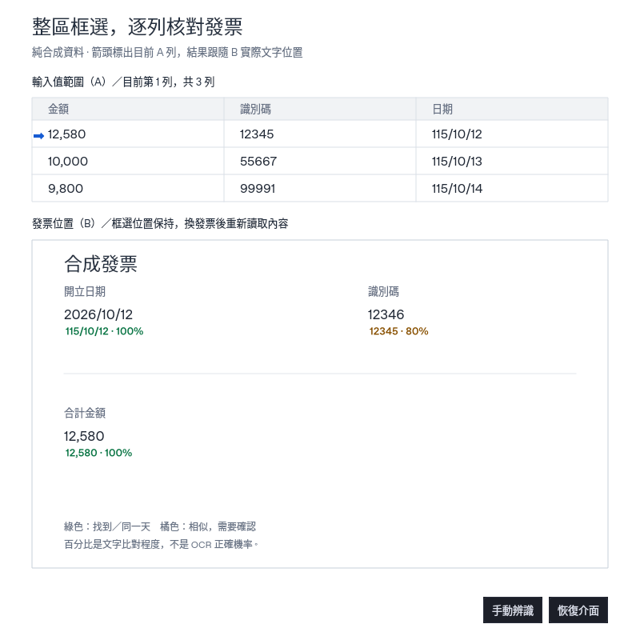

# 整列搜尋：整區輸入值逐列核對發票

A 是來源軟體的一整塊輸入資料，可以含多列、每列多個數值；B 是另一套軟體中可見的發票位置。預設「框選整區／逐列核對」：先辨識 B 的文字與位置，再讀取 A 整理各列，將目前列的每個值逐一對照。藍色箭頭標示目前 A 列，核對結果顯示在實際找到的 B 文字旁。

每個 A 數值最多採用一個 B 位置，同一個 B 文字位置也只能分配給一個值。原有「逐欄框選」可切換使用，同樣遵守位置不重複分配；另一個獨立功能「固定位置 A／B 核對」維持原操作。

## 第一次設定

1. 讓來源資料與發票同時顯示於主螢幕，控制窗移到讀取範圍外。點浮窗「整列搜尋」，或系統匣的「整列搜尋（數值核對發票）」。
2. 保持「框選整區／逐列核對」，按「框選輸入值範圍（A）」，一次圈住要核對的多列資料，不需要逐欄建立數值。
3. 按「框選發票位置（B）」，圈住共用的可見發票區；A 與 B 不可重疊。框好後會顯示「已框選」，可按旁邊「預覽／調整」確認內容。
4. 預設「數值核對／相似提醒」及「日期換算（民國／西元）」。按「開始搜尋」，控制窗收起，A 目前列旁出現藍色箭頭，B 顯示找到或相似的值與百分比。
5. 按「恢復介面」，用「上一列／下一列」切換已辨識出的列。箭頭及目前列的全部數值一起更新；整個 A 範圍與 B 範圍不移動，到了首尾會停用對應按鈕。
6. 在發票軟體切換下一張時，B 的框可以保持。搜尋中的像素檢查發現框內內容改變會重新讀取 B；想立即重讀，按浮動「手動辨識」。

所有來源都要保持可見。工具不能讀到被遮住、最小化、捲動區外或螢幕外的內容，也不替其他軟體點列或翻頁。

## A 會取出哪些值

整區模式依 OCR 文字行的位置分組，一次最多 100 列、每列最多 20 個值。會取十進位數字、支援的完整日期，以及含數字的西文識別碼；純中文姓名或只有英文字母的內容不會自動變成數值欄。要核對這類一般文字，切換「逐欄框選」，使用「框選數值／新增數值欄位」逐個設定，最多 20 欄。

同一個 OCR 行可以拆出多個值，但它們仍保留同一個真實文字行框，不捏造每個字元的位置。分組依畫面上文字行的高低及重疊判斷，沒有加入表格結構模型；合併儲存格、斜字、錯行、黏在一起的欄位或 OCR 未提供有效位置時，請縮小範圍或改逐欄框選。超過上限或部分資料無效時會提示需確認，不把截斷內容算成完整通過。

「上一列／下一列」在整區模式切換實際辨識到的列；逐欄模式則依「列高／間距」（1–500 螢幕像素，初始 30）一起平移各 A 框。兩種操作都不會替來源程式按鍵或捲頁。

## 預覽與調整位置

A、B、跟隨表格及逐欄位置旁都有「預覽／調整」。點擊會先暫停搜尋、隱藏標示，再取**一張主螢幕完整影像放在記憶體**，供移動框選位置；下方另顯示選取範圍的裁切預覽。

- 拖曳藍框移動，拖曳右下角改大小；「放大／縮小／顯示全畫面」只改預覽倍率。
- 箭頭按鈕每次微調 1 像素，按住 Shift 為 10 像素；不能移出影像或縮成無效範圍。
- 「套用位置」才更新範圍；「取消」保留原位置。兩者都不會自動恢復搜尋，確認後再按「開始搜尋」。
- 預覽是當下靜態畫面，來源之後改變不會在對話框內持續刷新。關閉／取消會清除完整影像及裁切圖，只保留範圍；不寫入圖片檔、歷史、剪貼簿或內容 Log。

## 找到、相似與位置分配

| 結果 | 意義與處理 |
| --- | --- |
| 綠色「找到」 | 文字／數值相符，或支援的日期換算為同一天，且沒有待確認訊號 |
| 橘色「相似／需確認」 | 顯示一個可用的近似候選，或辨識／位置仍需核對；人工採用近似也不變綠色 |
| 紅色「未找到」 | 沒有符合候選，不沿用前一列位置 |
| 「多處符合」 | 多個確切位置，回控制窗選一處再按「採用」，不自動取第一筆 |

確切符合及合法日期等價優先於近似。近似可以先顯示一個未被其他值使用的候選，方便直接看到差異；仍是橘色暫定結果。每個 B 位置只分配一次，其他值若沒有剩餘位置會提示需確認。高度重疊的 OCR 框也視為同一處；同位置出現互相矛盾的讀字結果不能算確定命中。

人工改選時，最新選擇接管同階段衝突的位置，原先那筆回到待核對，其他選擇保留；確切符合仍優先於近似。

位置精度仍是 OCR 文字行：若 B 把好幾個值讀成同一行、只有一個大文字框，不能把它假裝成多個獨立可分配位置，也不能保證指出行內重複數字中的某個字元。遇到這種情形，縮小 B 或改顯示倍率後重讀。

## 數字近似與百分比

百分比是「相同數字位數 ÷ 全部數字位數」，格式符號不算分母，**不是 OCR 正確機率，也不是金額誤差比例**。100% 但 OCR 低信心仍可能是橘色。畫面最多一位小數並向下截斷，不將近似四捨五入為 100%。

兩模式都要求單一十進位片段、至少兩位數字、位數及格式相同，保留正負號、貨幣符號、括號、小數點、千分位、百分號與前導零數量。不把 O／I 猜成 0／1，也不套用一般複製的標點清理。

| 模式／例子 | 處理方式 |
| --- | --- |
| 整區模式 | 相同位數至少 60% 才列近似，可有多位不同；全部近似都需確認 |
| `12345` 對 `12346` | 80%，橘色 |
| `12345` 對 `12399` | 60%，整區模式可列橘色候選 |
| `12` 對 `13` | 50%，整區模式不列近似 |
| 逐欄模式 | 沿用只差一位數字的規則，`12` 對 `13` 可顯示 50% 橘色；不代表高度接近 |
| `1.23` 對 `123`、`-100` 對 `100`、`1,000` 對 `1000`、`01` 對 `1` | 位數／格式不同，不列數字近似 |

一般文字沿用 95% 近似門檻，先統一 Unicode 等價組合（NFC），忽略一般空白標點，保留大小寫及全形／半形差異。西文詞與識別碼要求完整邊界，`Ann` 不命中 `Anna`、`123` 不命中 `INV123`；中文可在行內找子字串。「逐字完全相同」停用全部近似與日期換算。

## 民國／西元日期

預設開啟「日期換算（民國／西元）」。例如 A 的 `115/10/12` 和發票的 `2026-10-12` 代表同一天，顯示 100%，控制窗註明「日期換算」。仍保留兩邊原文；低 OCR 信心不因換算而變成確定命中。取消勾選可停用換算；「逐字完全相同」模式也會停用換算。

支援範圍：

- 「民國／中華民國」（也接受「民国」）後接 1–3 位且大於 0 的年；未寫年制的三位年視為民國，不能以前導 0 開始。
- 「西元／公元」或未寫年制的四位年視為西元，不能以前導 0 開始。
- `Y/M/D`、`Y-M-D` 或中文年月日，例如 `115年10月12日`；月份與日期各 1–2 位，必須是有效日期。
- 支援全形數字、斜線、連字號，以及已知中文年制後的冒號，例如 `民國：115/10/12`、`西元:2026/10/12`。

不猜未標年制的一／二位年、缺年月日、無效閏日或錯字；也不把時間、日期區間、嵌入識別碼、農曆、前紀元、AD／BC／ROC 等英文年制或年制括號當成可換算日期。上述不支援的年制前綴不會丟掉後硬套支援格式。

## 發票上的文字與透明度

上圖由合成 OCR 文字／位置經實際分列、取值、配對與 Qt 元件繪製，不包含使用者發票，也不是模型準確率或 Windows 原生置頂驗收。

標示只顯示 A 原值及百分比，優先放在已選定 B OCR 文字框下方；相似候選下方太擠時，會嘗試緊鄰文字框的右側或左側。維持文字點擊穿透，可操作下方文件。文字較長會省略，完整內容在控制窗。OCR 只給文字行時，位置也只精確到那一行，不能保證指出同一行重複數字中的某一個。

若尚未選定候選、找不到，或下方／可用側邊位置會重疊其他已選定文字框或標示，就不憑空放一個位置；「恢復介面」會提示未展開筆數，可回控制窗查看。

「標示背景透明度」範圍 0–100%，預設 100%：背景全透明，只保留清楚的數值與百分比；0% 使用白底。它只改標示底板，不把文字一起變透明，不觸發新辨識，也不會因調整設定恢復已暫停的結果。

「標示置頂」預設開啟，控制文字及「手動辨識／恢復介面」兩個小按鈕；控制窗保持一般視窗。切回來源程式或擷取恢復後依原設定維持置頂，不需重開。要暫停先按「恢復介面」，再按「暫停」。

## 自動輪次與手動辨識

開始後會按設定間隔擷取畫面，檢查內容是否改變。A、B 全部未變時略過 OCR；B 未變而 A 換列／內容改變時，保留一份有界的 B OCR 記憶體快取，只重新辨識 A。整區模式換列會重讀 A 整區，B 仍可重用；B 的位置相同但發票內容改變時，像素摘要不同就重新 OCR B，不沿用舊發票結果。快取仍核對像素與辨識設定，不把相同座標當成相同內容。

搜尋中可直接按浮動「手動辨識」，或控制窗同名按鈕：保持座標，撤銷舊一輪，重新辨識發票 B 及 A，即使畫面沒變也重新讀取。快速重複按不另開並行模型，過期回覆不覆蓋新結果。暫停／關閉時手動辨識不可用，不會暗中重新開始。

每次擷取前同時隱藏標示與兩個浮動按鈕，避免 OCR 讀到自己；恢復時可能短暫閃動。透明或置頂不能讓工具讀到被其他軟體遮住的原文。

## 手動換列與選取列跟隨

整區模式用「上一列／下一列」切換實際 OCR 列並移動目前列箭頭，整個 A／B 範圍保持；逐欄模式則依「列高／間距」（1–500 螢幕像素，初始 30）一起平移各 A 框並重新搜尋。這只移動讀取框，不替其他軟體點列或捲頁。手動換列會暫停自動跟隨；超出範圍不沿用舊結果。

自動跟隨步驟：

1. 先完成 A／B 框選，整區模式先搜尋一次取得可定位的目前列，再恢復介面並暫停。在來源軟體選取基準列，保持清楚均一的選取底色。
2. 按「框選輸入表格（換列用）」，只圈可跟隨的來源表格，避開工具列、固定標題及同色面板。
3. 設定列高，按「校正目前選取列」，在 3 秒倒數內回到來源軟體選好基準列。
4. 開啟「自動跟隨表格」再開始搜尋。新底色列連續兩次檢查穩定後，整區模式切換目前列，逐欄模式把 A 框一起移到新列；同一 Y 座標換入新內容也會更新。

這是畫面底色追蹤，不讀取其他軟體的資料庫、控制項或語意游標。底色消失、多個可能選取列或越界時不猜位置；白底、斑馬紋、多重選取、動畫、主題改色或不等高列可能無法可靠跟隨。改用手動換列，或重新框選／校正。無法確認新列時仍按間隔檢查；要停止等待請按暫停或關閉。

來源改縮放、移動欄位或改變列距後，請重新確認位置與列高。新增／移除欄位、改框或改列高會撤銷先前校正。要處理下一頁，先在來源軟體操作，必要時重新框選。

## 相關 Repo 與本版選擇

本版沿用既有 OCR 的文字行與位置，再以有數量上限的 Python 標準庫規則分列、取值與分配位置，沒有加入新的原生套件或模型。以下是接入評估，不是已整合功能：

| Repo | 可協助的部分 | 接入代價與本版決定 |
| --- | --- | --- |
| [RapidFuzz](https://github.com/rapidfuzz/RapidFuzz) | 快速字串近似比對，MIT 授權 | 不產生 OCR／表格位置；Windows 原生 wheel 另有執行環境依賴。現有有限數字規則已可處理此次需求，暫不新增依賴 |
| [PaddleOCR／PP-Structure](https://github.com/PaddlePaddle/PaddleOCR) | 文件版面及表格結構、儲存格與文字分析 | 需額外模型、推論環境及離線封裝驗證；可評估行框不足或合併儲存格情境，不能直接保證提升既有 OCR 字元準確率 |
| [Table Transformer](https://github.com/microsoft/table-transformer) | 表格偵測及結構辨識，可與另一套 OCR 結合 | 該 Repo 已封存，另需 PyTorch／模型權重；更新維護及成品體積成本較高，本版不接入 |

若後續需要精確到儲存格或行內字元，應另用合成與經同意的代表樣本評估定位、辨識率、速度及離線大小；目前的文字行框不能當成已具備這些能力。

## 停止、暫存與保留資料

開窗不自動搜尋；開始或手動換列才啟動，校正另做一次取樣。暫停、改框、清除或關閉停止後續工作、取消排隊並清除過期標示；已進入原生 OCR 的單次呼叫需先返回。晚到回覆不能重開視窗。關閉後不在背景繼續跟隨。

模式共用既有離線 OCR 工作者，不另開模型。每輪取包住已選範圍的共用快照，再於記憶體裁出 A／B；範圍間畫素可能短暫存在，不留檔。結果發表前再次檢查畫面，內容變更就丟棄該輪。

座標、校正、結果與有界快取只留本次執行記憶體，當輪影像完成／取消後釋放。不把 A／B 圖片或文字寫入歷史、剪貼簿、匯出、內容 Log 或新截圖檔，也不上傳。不提供跨次啟動的配置復原；一般 OCR 歷史、90 天封存及 Log 規則維持原樣。

找到相同字串或同一天，仍不保證原始資料輸入正確。實際同版驗證範圍見 [驗證說明](VALIDATION_COVERAGE.md) 與 Release 的 validation metadata。
