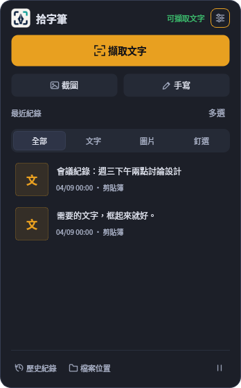
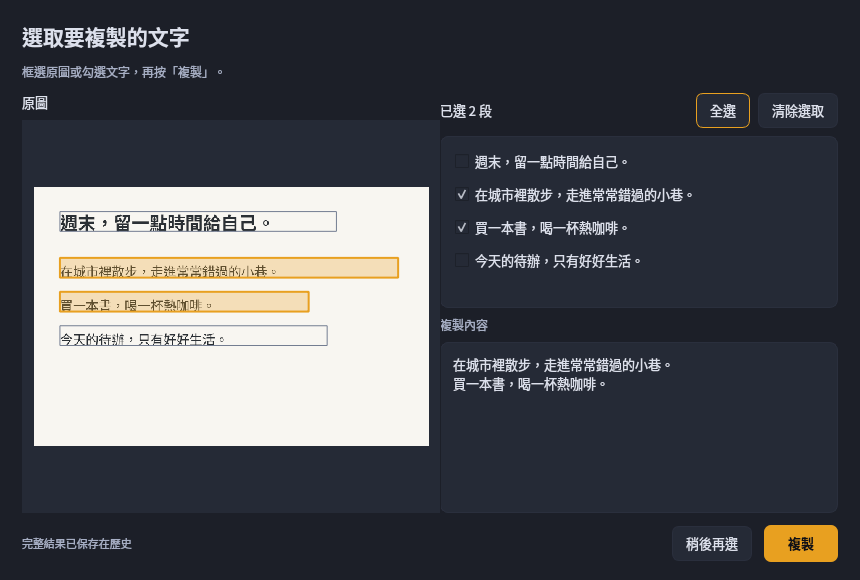

# 浮動窗與 OCR 選取流程

本次調整服務既有 Windows 離線工具的日常操作：少讀說明，框選後辨識，依設定複製全文或選取部分文字。保留 InkPick 品牌、深色與琥珀色 tokens、既有資料格式及 OCR 引擎，並整合已發布 rc.2 的手寫與隱私修正。

以下為實際 Qt 畫面，使用虛構的示範內容：

## 介面

- 浮動窗以「擷取文字」為主操作，截圖與手寫為次要操作；狀態只顯示短句，細節保留在工具提示。
- 最近紀錄保留全部／文字／圖片／釘選、右鍵操作與多選。過長文字省略顯示，可由提示查看。
- 底部提供歷史紀錄與「檔案位置」；可開啟截圖、標註附件、縮圖、匯出、歷史、設定、Log 與這次 EXE 解開的程式暫存。使用實際路徑，不建立空目錄，不將共用系統 Temp 誤稱為本程式資料。
- 搜尋移至歷史視窗，Ctrl+Shift+Q 直接聚焦該視窗的搜尋欄。
- 篩選淡入、進度顯示及選取視窗淡入使用原生 Qt；動畫遵循系統偏好，不加入網頁框架、遠端字型或執行期網路依賴。

## 選取與複製

1. 擷取與辨識照原流程儲存完整結果；預設辨識完成後自動複製全文，保留舊版操作。
2. 「設定 → 剪貼簿 → 辨識完成後」改為「先選文字再複製」時，成功的目前結果才開啟非模態選取視窗，預設未選取，剪貼簿不變。儲存立即生效。
3. 可在原圖點選文字框或拖曳框選，Ctrl 拖曳加選；也可勾選文字區塊，支援鍵盤操作。
4. 複製預覽可修改、反白一小段；按「複製」才套用既有複製清理選項並寫入剪貼簿。全選保留完整辨識文字與換行。
5. 取消或關閉視窗不複製。原圖依原設定未保留時，仍能使用文字選取。

選取與預覽編輯不修改資料庫原文或待確認狀態。複製當下再次檢查工作編號、修改版本、刪除及關閉狀態，避免過期視窗複製舊內容。稍後的手寫或歷史手動複製會抑制較早 OCR 的自動提示；使用者已開啟視窗後明確按複製，則以這次選擇為準。關閉程式時先關閉選取視窗，再依原有順序完成背景工作。

## 參考取捨

| 參考 | 本次採用 |
| --- | --- |
| [Beautiful UI](https://www.beautifului.dev/) | 清楚的載入、進度與選取操作狀態 |
| [beUI](https://beui.dev/)、[Rare UI](https://www.rareui.com/) | 輕量互動回饋、明確元件層級 |
| [Transitions](https://transitions.dev/) | 短暫且可中斷的狀態過渡 |
| [shadcn/ui](https://ui.shadcn.com/) | 一致的間距、聚焦與停用狀態 |
| [oil-ui](https://github.com/oil-oil/oil-ui) | 單一主操作與實際畫面檢視 |
| [UI UX Pro Max](https://github.com/nextlevelbuilder/ui-ux-pro-max-skill) | 沿用設計系統，拖曳提供點選與鍵盤替代 |
| [Impeccable](https://github.com/pbakaus/impeccable) | 工具介面的掃讀、留白與簡潔文案 |

這些資源用於設計參考，程式仍採用 PySide6 原生元件。Google Stitch、Uizard、Visily、Figma 與墨刀無需連接，即可完成本次修改。

## 驗證範圍

Qt 互動測試涵蓋預設全文複製、舊設定相容、選取模式立即生效、部分／全部／反白複製、原圖座標縮放、框選加選、鍵盤勾選、缺圖與異常框線，以及 SQLite 歷史與剪貼簿完整性。保留人工修改、刪除、重辨識、關閉及複製清理的保護。

實際畫面以 Linux Qt offscreen 在一般與 200% 比例檢視；這不能替代原生 Windows 的多螢幕、觸控與檔案總管驗收。rc.3 EXE 的同次 Windows 建置、阻斷網路與隔離資料測試以 Release 公開驗證摘要為準，不沿用前一版本結果。

初版介面調整在 2026-11-02 的本機紀錄（尚未整合 rc.2 與雙模式設定，僅供歷史對照）：

- `QT_QPA_PLATFORM=offscreen python -m pytest -q`：745 passed、13 skipped；略過項目為 Windows／PowerShell 原生門檻。
- `python src/main.py --self-test`：通過 Qt、雙模型 OCR 與資料庫檢查。
- `python src/main.py --smoke-app`：引擎就緒、所有背景執行緒停止、資料庫完整性正常。
- `python scripts/probe_handwriting_helper.py`：通過原生 helper 檢查。
- Ruff 致命錯誤檢查、選取視窗與流程檔完整 lint、`pip check`、`git diff --check` 均通過。
